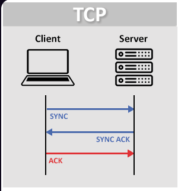
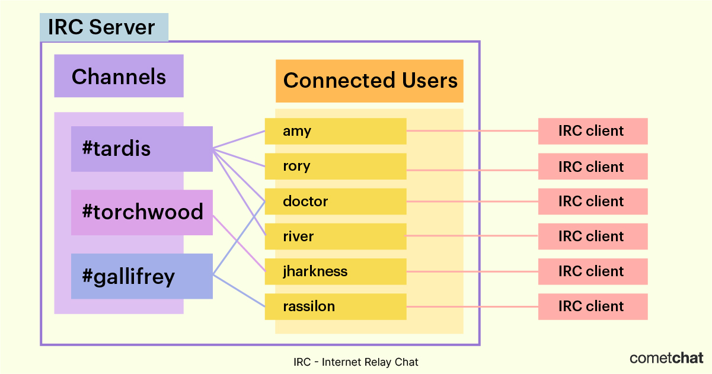
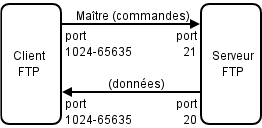
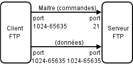
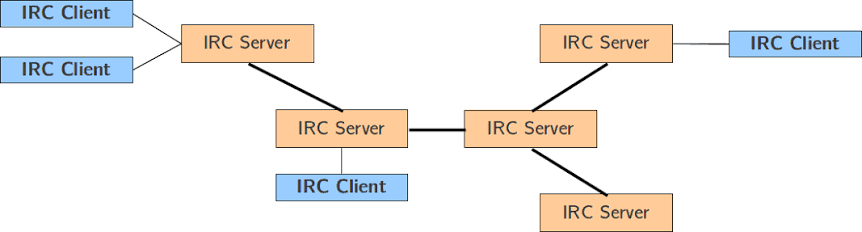
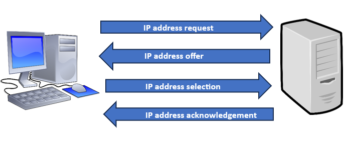
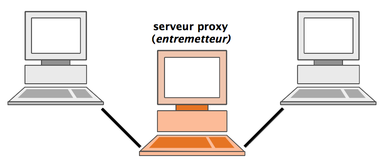
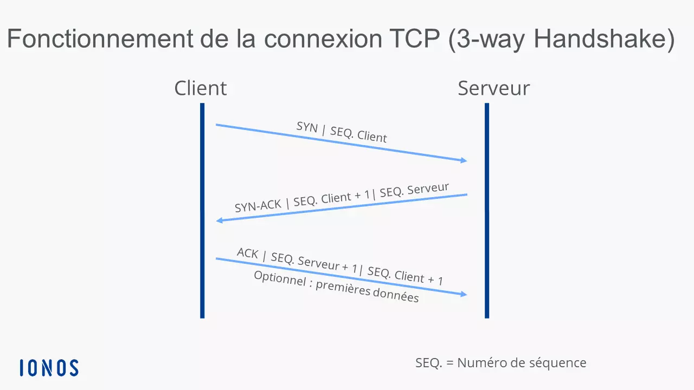
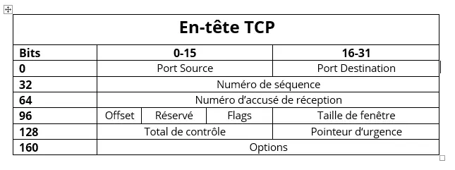

***This project has been created as part of the 42 curriculum by dgorceac, mleschev.***

<h1 align="center"> 

FT_IRC 

</h1>

  - sommaire - 

 

 

<ul>
	<li>
	IRC 42 curriculum project
		<ul> 
				<ul>
					<li>

[Protocols internet:](#protocols-internet)</li>
						<ul>
							<li>

[TCP (Stream Sockets)](#stream-sockets-tcp)
							</li>
							<li>
							
[UDP (User Datagram Protocol):](#user-datagram-protocol-udp)</li>
							<li>
							
[IRC (Internet Relay Chat):](#irc-internet-relay-chat)</li>
							<li>
[Les protocoles de transfert de fichier](#le-transfert-de-fichier)
								<ul>
									<li>
[FTP (File Transfer Protocol)](#ftp-file-transfer-protocol)</li>
									<li>
[SCP (Secure Copy Protocol)](#scp-secure-copy-protocol)</li>
									<li>
[SFTP (SSH File Transfer Protocol)](#sftp-ssh-file-transfer-protocol)</li>
									<li>
[Mode D'Utilisation :](#mode-dutilisation-)</li>
								</ul>
							</li>
						</ul>
					</li>
					<li>
					
[Specificite d'IRC](#specificite-dirc)
						<ul>
							<li>
[Format du message](#format-du-message)</li>
							<li>
[Decoupage des messages IRC](#decoupage-des-messages-irc-)</li>
							<li>
[Moyen d'accès:](#moyen-daccès)</li>
							<li>
[Fonctionnement serveur](#fonctionnement-serveur)</li>
							<li>
[Numeric replies](#numeric-replies)</li>
						</ul>
					</li>
					<li>
[Channel IRC:](#channel-irc)
						<ul>
							</li>
[Enregistrement de connexion](#enregistrement-de-connexion-)</li>
							<li>
[Les Grades](#les-grades)
								<ul>
									<li>
[Les Utilisateurs normaux](#les-utilisateurs-normaux)</li>
									<li>
[Les Voices](#les-voices)</li>
									<li>
[Les Half-Ops (Semis-Opérateurs)](#les-half-ops-semis-opérateurs)</li>
									<li>
[Les Ops (Opérateurs du salon)](#les-ops-opérateurs-du-salon)</li>
									<li>
[Les Admins](#les-admins)</li>
									<li>
[L'Owner et le Founder](#lowner-et-le-founder)</li>
								</ul>
							</li>
						</ul>
					<li>
[Les commandes IRC et leur définition](#les-commandes-irc-et-leur-définition)
						<ul>
							<li>
[Connexion](#connexion)	</li>
							<li>
[Canaux](#canaux)</li>
							<li>
[Communication ](#communication-)</li>
							<li>
[Déconnexion ](#déconnexion-)</li>
						</ul>
					</li>
						<li>
[Les modes](#les-modes)
							<ul>
								<li>
[modes de communication réseau](#modes-de-communication-réseau)
									<ul>
										<li>
[Modes de canal](#modes-de-canal)</li>
										<li>
[Mode bloquant](#mode-bloquant)</li>
										<li>
[Mode non bloquant](#mode-non-bloquant)</li>
										<li>
[asynchrones](#asynchrones)</li>
									</ul>
								</li>
								<li>
[Les MODES IRC](#les-modes-irc)
									<ul>
										<li>
[Mode d'utilisateur](#mode-dutilisateur)</li>
										<li>
[Modes de canal](#modes-de-canal)</li>
										<li>
[Exemples](#exemples-des-modes-irc)</li>
									</ul>
								</li>
							</ul>
						</li>
				</ul>
		</ul>
		<li> 
[Vocabulaire Divers](#vocabulaire)</li>
	</li>
	<li>
[SOURCES](#sources)
</ul>

 

---

# Protocols internet:

<h3 align="center">

## Stream Sockets (TCP):

</h3>

Datagram Sockets (TCP) (Transmission Control Protocol) est un protocole fondamental de la couche transport des réseaux informatiques. 

Il garantit une transmission fiable, ordonnée et sans erreur des données entre des applications connectées à Internet, fonctionnant de concert avec le protocole IP.

Fonctionnement principal:
- Mode connecté : Une liaison est établie entre l'émetteur et le récepteur avant tout échange de données.
- Poignée de main ([Handshake](#handshake)) en trois étapes ([3-way handshake (TCP handshake)](#3-way-handshake)) : La connexion s'initialise via l'envoi successif de signaux 
	- [SYN](#syn-client-vers-serveur)
	- [SYN ACK](#syn-ack-synchronize-acknowledgment-serveur-vers-client) 
	- et enfin [ACK](#ack-client-vers-serveur).
- Fiabilité :
	- Chaque paquet envoyé possède un numéro de séquence et nécessite un accusé de réception ([ACK](#ack-client-vers-serveur)).
	- Correction des pertes : Si un segment est perdu en chemin, TCP le détecte et demande sa retransmission.
	- Contrôle de flux et congestion : Le protocole ajuste dynamiquement la vitesse d'envoi pour éviter de saturer le réseau ou la machine réceptrice.

<h3>

## User Datagram Protocol (UDP):

</h3>

<h5>
UDP (User Datagram Protocol) - est un protocole de la couche transport (couche 4) des modèles OSI et TCP/IP. Il fonctionne en mode non connecté : il envoie des données (datagrammes) rapidement sans vérifier la liaison, sans accuser réception et sans garantir l'ordre d'arrivée des paquets.Caractéristiques principales d'UDPNon orienté connexion : aucun échange préalable (pas de handshake) n'est requis avant l'envoi.Léger et rapide : l'en-tête fait seulement 8 octets, ce qui réduit la surcharge réseau.Non fiable : pas de retransmission en cas de perte, de duplication ou de désordre des données.
<h5>

<h3><u>

## IRC (Internet Relay Chat):

</u></h3>

<h5 align="center">Internet Relay Chat (IRC ; en français : « discussion relayée par Internet ») est un protocole de communication textuel sur Internet. Il sert à la communication instantanée principalement sous la forme de discussions en groupe par l’intermédiaire de canaux de discussion, mais il peut aussi être utilisé pour de la communication entre deux personnes seulement. Il peut par ailleurs être utilisé pour faire du transfert de fichier

 

IRC est un protocole utilisant TCP et de façon optionnelle TLS. Un serveur IRC peut se connecter à d’autres serveurs IRC. Un réseau IRC est un ensemble de serveurs IRC connectés l’un à l’autre relayant si nécessaire les messages, formant ainsi une architecture répartie. L’utilisateur utilise un logiciel client IRC afin de se connecter à un des serveurs du réseau, le choix du serveur étant indifférent.

 

Fonctionnement technique :
	
	Modèle client-serveur :
	 Un logiciel client (comme HexChat ou Irssi) se connecte à un serveur distant.
	 
	 Réseau de serveurs :
	  Les serveurs peuvent être reliés entre eux pour former un réseau global et propager les messages.
	  
	  Mode texte brut :
	   Les commandes et les messages transitent en clair (généralement en ASCII) sur un port standard (souvent le 6667).

 

Les connexions client-serveur IRC fonctionnent via TCP/IP. Les ports standard pour ces connexions sont TCP/6667 pour le texte clair et TCP/6697 pour les connexions TLS.

</h5>

<h5>

Programmes de sockets client/serveur : 
- [appel de sockets](#socket)

3 Modes

- [Mode bloquants](#mode-bloquant)

- [Mode non bloquant](#mode-non-bloquant)

- [asynchrones](#asynchrones)

</h5>

## Le transfert de fichier

Le transfert de fichier peut se faire d'ordinateur à périphérique, de serveur à serveur, de client à serveur, ou de client à client par l'intermédiaire d'un serveur de messagerie électronique

Le transfert de fichier via un réseau informatique se fait à l'aide de protocoles réseau et d'applications adaptées. Le FTP, est un protocole spécifique pour le partage de fichiers, ou encore le [SCP](#scp-secure-copy-protocol) ou le [SFTP (SSH File Transfer Protocol)](#sftp-ssh-file-transfer-protocol). Elles peuvent emprunter différents réseaux, tels qu'un réseau X.25 ou l'Internet.

### FTP (File Transfer Protocol)

	Principe : C'est le plus ancien (créé en 1971).

	Sécurité : ❌ Aucune. 

	Les identifiants, les mots de passe et les fichiers 
	transitent sur le réseau en texte brut. 
	Un attaquant peut facilement intercepter 
	vos données (via un sniffer comme Wireshark).

	Fonctionnement : Il utilise deux canaux distincts 
	(généralement le port 21 pour les commandes et un 
	autre port pour les données), ce qui le rend 
	difficile à configurer derrière des pare-feux (Firewalls)
 

FTP peut s'utiliser de deux façons différentes.

 

|Mode Actif|          |Mode Passif|
|:----:|----------|:------:|
||	||

### SCP (Secure Copy Protocol)

	Principe : C'est une commande de transfert de 
	fichiers ultra-rapide basée sur le protocole SSH (Secure Shell).

	Sécurité : 🔒 Sécurisé. Tout le trafic (mots de passe et fichiers) est entièrement chiffré.

	Fonctionnement : Il utilise un seul port (le port 22 par défaut). 
	Il est idéal pour copier rapidement un fichier ou un 
	dossier d'une machine à une autre en ligne de commande, 
	mais il ne permet pas de naviguer graphiquement dans 
	les dossiers du serveur ni d'interrompre/reprendre un transfert.

### SFTP (SSH File Transfer Protocol)

	Principe : C'est le successeur moderne et sécurisé du FTP. 
	Bien qu'il s'appelle "SFTP", il n'a aucun rapport technique 
	avec le protocole FTP : 
	c'est une extension complète du protocole SSH.

	Sécurité : 🔒 Sécurisé. Tout est chiffré (port 22 par défaut).

	Fonctionnement : Contrairement à SCP, SFTP est un protocole interactif. 
	Il permet de lister les fichiers, créer des dossiers, supprimer 
	des éléments, et surtout, reprendre un transfert de fichier 
	interrompu. C'est le protocole standard utilisé aujourd'hui 
	par les clients graphiques comme FileZilla ou Cyberduck.

 

### Mode D'Utilisation :

Pour accéder à un serveur FTP, on utilise un logiciel (client FTP). Ces logiciels existent avec ligne de commande ou avec une interface graphique. Le standard FTP est si répandu que ces logiciels sont à présent inclus avec les dernières distributions Windows & Linux.
 
 
L'utilisation en ligne de commande, sous Windows comme sous Linux, se fait généralement au moyen de la commande ftp adresse_du_serveur saisie dans une console. (ici, ftp est le nom du logiciel, et le paramètre le nom du serveur)

# Specificite d'IRC

<h5>

La plupart des serveurs IRC ne nécessitent pas l’enregistrement par l’intermédiaire d’un compte, l'utilisateur pouvant alors choisir son nickname (surnom) librement tant qu'il est disponible.</h5>

#### Format du message

	Un message IRC est une seule ligne, délimitée par une paire de caractères CR ('\r', 0x0D)« et LF ('\n', 0x0A)».

	Lors de la lecture de messages provenant d'un flux, chargez les données entrantes dans une mémoire tampon. Ne traitez un message qu'à partir du moment où vous rencontrez le \r\ncaractère de fin. Si vous rencontrez un message vide, ignorez-le silencieusement.
	Lors de l'envoi de messages, assurez-vous qu'une paire de \r\ncaractères suive chaque message envoyé par votre logiciel.

	⚠️Un message IRC se termine toujours par \r\n ⚠️

	exemples :

	NICK Bob\r\n
	JOIN #42\r\n
	PRIVMSG #42 :Salut tout le monde\r\n

 

#### Decoupage des messages IRC :

		:Bob!bob@localhost
			│
			└── prefix

	PRIVMSG
	│
	└── commande

	#42
	│
	└── paramètre

	:Salut
	│
	└── trailing parameter

#### Moyen d'accès:

<h5 align="center">
L'accès d'utilisateur à un réseau IRC se fait historiquement au moyen d'un logiciel dit « Client IRC » aussi appelee ircOp
</h5>

## Fonctionnement serveur

	Exemple :

	Bob:

	JOIN #42

	Le serveur doit :

	1. vérifier que le channel est valide (le channel existe ?)
	2. vérifier +i (invite ?)
	3. vérifier +k (bon Mot de passe ?)
	4. vérifier +l (asser de place d'users ?)
	5. ajouter l'utilisateur 
	6. envoyer les messages appropriés aux membres.

	Ajout de Bob :

	Bob reçoit JOIN
	membres reçoivent JOIN
	envoi topic / liste utilisateurs

 
 
 
 
 

## Numeric replies

 

	Le serveur répond avec des codes numériques (des messages de trois chiffres) :

	001
	002
	003
	...

 

	Chaque réponse numérique respecte le format standard suivant :

	:<nom_serveur> <code_numérique> <pseudo_cible> <paramètres> :<message>

 

	Catégories principales001 à 099 : 
	Messages de bienvenue et informations initiales sur le serveur lors de la connexion.

	200 à 399 : Réponses de commandes réussies (statistiques, listes de canaux, informations utilisateurs).

	400 à 599 : Messages d'erreur (canal plein, pseudonyme déjà utilisé, privilèges insuffisants).

 

	Exemples de codes très courants:

| Code | Nom standard | Description |
| :--: | :--: | :--: |
|001|RPL_WELCOME|Confirmation de la connexion réussie au réseau.|
|322|RPL_LIST|Confirmation de la connexion réussie au réseau.|
|332|RPL_TOPIC|Renvoie le sujet actuel du canal lors de l'enrée sur celui-ci.|
|353|RPL_NAMREPLY|Renvoie le sujet actuel du canal lors de l'enrée sur celui-ci.|
|401|ERR_NOSUCHNICK|Erreur : Le pseudonyme ou le canal spécifié n'existe pas.|
|433|ERR_NICKNAMEINUSE|Erreur : Le pseudonyme choisi est déjà attribué à un autre utilisateur.|
|473|ERR_INVITEONLYCHAN|Erreur : Le pseudonyme choisi est déjà attribué à un autre utilisateur.|

 

	Pour Ft_IRC, on dois surtout connaître les numeric replies exigées par le sujet plutôt que d'essayer d'implémenter toute la RFC.

 
 
 
 
 
 

# Channel IRC:

<h5 align="center">
L’élément de base pour communiquer sur un réseau est le canal (channel dans la spécification). Un canal est défini par une liste d’utilisateurs connectés sur celui-ci. En français, un canal est comparable au mot "salon"

 

Les canaux peuvent être vus de tout le réseau, leur nom est alors préfixé par le caractère croisillon « # » ; ils peuvent aussi être des canaux locaux, portés par un serveur uniquement, leur nom est dans ce cas préfixé par le caractère esperluette « & ».
</h5>

#### Enregistrement de connexion :

	Dès l'établissement de la connexion, le client doit tenter de s'inscrire, sans attendre aucun message d'avertissement du serveur.

	Tant que l'enregistrement n'est pas terminé, seul un nombre limité de commandes devrait être accepté par le serveur. En effet, il est logique d'exiger une connexion client enregistrée (entièrement établie) avant d'autoriser des commandes telles que JOIN`sudo` PRIVMSGet autres.

	L'ordre recommandé des commandes lors de l'enregistrement est le suivant :

	1. CAP LS 302
	2. PASS
	3. NICKetUSER
	4. Négociation des capacités
	5. SASL(si négocié)
	6. CAP END

## Les Grades

<h5 align="center">En IRC, il existe plusieurs grades principaux :</h5>

### Les Utilisateurs normaux

##### ils ne sont marqués avec aucun signe à gauche de leur pseudonyme dans la liste des personnes du salon. Ils n’ont aucun droit sur le salon, sauf celui de parler (si le salon est en -m), ils peuvent t’chatter (même condition). Remarquez que si le salon est en mode -t ils peuvent modifier ou mettre le sujet de salon normalement.

 

###	Les Voices

##### ils sont des utilisateurs ayant reçus le mode +v sur un canal de discussion. Ils ne peuvent pas éjecter ou bannir, et n’ont aucun pouvoir sur le salon (comme des utilisateurs normaux). On voice quelqu’un car il peut être ami, personne appréciée.. Cela dépend des salons. Les voices sont en haut de la liste des pseudos (en bas des half-ops) et se font mieux remarquer. Lorsque le salon est en +m, les voices peuvent toujours tchatter (les modérateurs aussi) mais pas les utilisateurs normaux.

 

### Les Half-Ops (Semis-Opérateurs)

##### ils sont des utilisateurs ayant reçus le mode +h sur un canal de discussion. Ils peuvent changer le sujet du salon (le topic) même lorsque le salon est en +t, et ils peuvent éjecter (kicker) ou bannir (ban) quelqu‘un. Ils peuvent appliquer certains modes sur le salon et mettre les personnes qu’ils veulent voice. Ils peuvent appliquer l’option +e sur des personnes, afin que cette personne ne puisse pas être bannie du salon de t’chat pendant qu’elle a l’option +e sur le salon. Une personne bannie du salon a le mode +b. Pour bannir quelqu‘un du salon , il faut écrire /mode #NOM_DU_SALON +b XXX. Reportez vous au chapitre Bannissements pour savoir avec quoi peut-on remplacer le XXX. Pour voicer quelqu`un, l’half-op doit écrire /mode #NOM_DU_SALON +v XXX en remplaçant XXX par le nom de la personne. à noter que certains réseaux IRC ne disposent pas de ce mode d'utilisateur.

 

### Les Ops (Opérateurs du salon)
##### les utilisateurs ayant reçus le mode +o sur un canal de discussion, ont les mêmes pouvoirs que les half-ops mais peuvent appliquer certains modes sur le salon que les half-ops ne peuvent pas (salon privé, salon en +l, protection contre le flood, bloquage de messages couleurs etc.).

 

### Les Admins 
##### ce sont des utilisateurs ayant reçus le mode +a sur un canal de discussion. Sous unreal IRCd, ce mode est attribué à un utilisateur ayant un acces d'au moins dix sur un canal de discussion. Il peuvent modérer les opérateurs et changer une partie de la configuration d'un canal, retirer ou ajouter des accès inférieur à leur niveau.

 

### L'Owner et le Founder 
##### c'est un utilisateur ayant reçu le mode +q sur un canal de discussion. L'Owner peut modifier complêtement la configuration du canal de discussion et déléguer son statut d'owner à un autre utilisateur.

# Les commandes IRC et leur définition

> [!CAUTION]
> pour TOUT les exemples on definit :
>
> {CHANNEL} = #42
>
> {USER} =	Bob
>
> {MESSAGE} =	Hello World !

### Connexion:

PASS

 

NICK {USER} 
 
Le client choisit son pseudonyme

 

{USER}
 
fournit les informations utilisateur nécessaires à l'enregistrement.

 

CAP

 

 
 

### Canaux:

 
 

JOIN

 

PART {CHANNEL} 
 
Quitter un channel mais l'{USER} restes connecté au serveur.

 

KICK {CHANNEL}  {USER} :{MESSAGE} 
 
Un opérateur expulse {USER} pour {MESSAGE} mais peut rester connecté au serveur

 

INVITE {USER} {CHANNEL}
 
Un opérateur peut inviter {USER} a {CHANNEL}

 

TOPIC {CHANNEL}
 
Lire le message du {CHANNEL}

 

TOPIC {CHANNEL} :{MESSAGE}
 
Avec +t, seuls certains utilisateurs peuvent le modifier.

 

MODE

 

 

### Communication :

PRIVMSG {USER} :{MESSAGE} 
 
Le serveur transmet {MESSAGE} à {USER}.

 

PRIVMSG {CHANNEL} :{MESSAGE} 
 
Le serveur doit envoyer le message aux autres membres de {CHANNEL}.

 

NOTICE

 

 

### Déconnexion :
 
 

QUIT :{MESSAGE}
 
La connexion TCP est fermée.

# Les modes

il ne faut pas confondre :

- les modes de communication réseau (bloquant/asynchrone)  
- les modes IRC (qui sont des commandes de configuration)

## modes de communication réseau

 

### Mode bloquant
 

> [!CAUTION]
MODE PAR DEFAUT
<h6 align="center">
Le programme s'arrête complètement et attend que l'action soit terminée avant de continuer. Par exemple, s'il attend une connexion d'un client, rien d'autre ne se passe tant que ce client n'arrive pas. C'est simple à programmer mais ça peut « geler » l'application.

</h6>
 

	Le problème du mode bloquant : Par défaut, 
	si vous tentez de lire (read/recv) sur une socket classique 
	et qu'aucun message n'est envoyé, le programme s'arrête et attend. 
	Pendant cette attente, le serveur est totalement figé : il ne peut pas
	traiter les autres utilisateurs, accepter de nouvelles connexions ou 
	relayer les messages des canaux.

 
 

### Mode non bloquant

<h6 align="center">

Mode non bloquant ircMode non bloquant irc Le mode non bloquant (ou non-blocking) dans le contexte d'un serveur ou d'un client IRC (Internet Relay Chat) signifie que les opérations d'entrée/sortie (E/S ou I/O) sur les sockets réseau s'exécutent immédiatement sans jamais interrompre ou figer le programme, même si aucune donnée n'est prête à être lue ou écrite. Cette architecture est indispensable pour qu'un serveur IRC puisse gérer des milliers de connexions simultanées de manière fluide.

</h6>

 

	Pourquoi le non-bloquant est indispensable en IRC :

	En configurant les sockets en non-bloquant, les fonctions 
	de lecture et d'écriture renvoient instantanément une erreur 
	spécifique (comme EWOULDBLOCK ou EAGAIN) si l'opération 
	ne peut pas être effectuée immédiatement. 
	Le programme passe alors instantanément à la suite sans perdre de temps.

[SOCKET](#socket)

[EWOULDBLOCK](#ewouldblock)  

[EAGAIN](#eagain)

 
 

### asynchrones

L'IRC asynchrone (ou Asynchronous IRC) désigne l'utilisation du protocole Internet Relay Chat (IRC) de manière différée, permettant à un utilisateur de lire et d'envoyer des messages sans être connecté en permanence et en temps réel au serveur.Pour transformer ce protocole initialement synchrone en un outil de communication asynchrone (similaire à Slack, Discord ou Matrix), plusieurs méthodes et outils sont utilisés :

[Les Bouncers IRC (BNC)](#bouncers)

[Les clients IRC modernes et d'architecture Client-Serveur](#clients-irc)

[Les passerelles (Bridges) vers des protocoles asynchrones](#protocoles-asynchrones)

 
 
 
 

## Les MODES IRC

<h5 align="center">

 
Les modes sont des options positionnées sur des canaux ou des utilisateurs, et qui affectent leur mode de fonctionnement, leurs privilèges et leurs interactions avec les autres entités de l’IRC.
</h5>
 

<u><h5>

## Mode d'utilisateur
</h5></u>

| Lettre | Symbole | Description |
|:--------: |:--------:| :--------:|
| i     |    | Invisible : en dehors de la participation commune à un canal, l'utilisateur n'est pas visible par les autres.    |
| s     |    | Reçoit toutes les notifications du serveur.    |
| w     |    | Reçoit tous les messages envoyés par la commande « wallop ».    |
| o     |    | L'utilisateur est un opérateur IRC (à ne pas confondre avec le mode de canal « o »).    |

	La syntaxe est :

	MODE <pseudo> <mode>

<u><h5>
 
 
 
 
 

## Modes de canal

</h5></u>

| Lettre | Lettre | Paramètre | Description |
|:--------: |:--------:| :--------:| :--------:|
| o     | @   | nom de l'utilisateur concerné    | Opérateur de canal : peut changer les modes du canal et expulser les autres utilisateurs.    |
| a     | & / @   | nom de l'utilisateur concerné    | ChanMaster : peut changer les modes du canal poser des ban permanents et expulser les utilisateurs.    |
| q     | ~ / @   | nom de l'utilisateur concerné    | Owner : propriétaire d'un canal à un accès complet sur le canal.    |
| h     | %   | nom de l'utilisateur concerné    | Halfop : a un accès limité aux commandes, voice et devoice les utilisateurs, expulser et bannir des utilisateurs sur une courte durée.    |
| v     | +   | nom de l'utilisateur concerné    | Verbose ou Voiced : autorise l'utilisateur à parler sur un canal modéré (mode « +m »).    |
| s     |    |     | Canal secret ; le canal est totalement invisible.    |
| p     |    |     | Canal privé; le nom du canal est invisible.    |
| n     |    |     | Les messages externes ne sont pas autorisés.    |
| m     |    |     | Canal modéré, seuls les utilisateurs en mode « +v » et les opérateurs peuvent envoyer un message.    |
| i     |    |     | Canal accessible uniquement sur invitation (commande « /invite »).    |
| t     |    |     | Sujet du canal uniquement modifiable par les opérateurs du canal.    |
| l     |    |limite| Fixe la limite du nombre d'utilisateurs sur le canal à « limite ».    |
| b     |    |utilisateur| Bannit l'utilisateur « utilisateur ».    |
| k     |    |clef| Seuls les utilisateurs connaissant la clé « clef » pourront se connecter au canal.    |

 
 
 
 

### EXEMPLES DES MODES IRC

 

EXEMPLES DES MODES SUR UN CHANNEL #42:
		
		+i
	Channel sur invitation.
	MODE #42 +i

		+t
	Seuls certains utilisateurs peuvent changer le topic.
	MODE #42 +t

		+k
	Mot de passe du channel.
	MODE #42 +k secret

		+o
	Donner les droits opérateur :
	MODE #42 +o Bob

		+v
	Donner la voix :
	MODE #42 +v Bob

		+l
	Limiter le nombre d'utilisateurs :
	MODE #42 +l 10

		+b
	Bannir :
	MODE #42 +b Bob

		+m
	Channel modéré :
	MODE #42 +m
 

EXEMPLES DES MODES SUR UN USER:
		
		+i
	Channel sur invitation.
	MODE USER +i

		+t
	Seuls certains utilisateurs peuvent changer le topic.
	MODE USER +t

		+k
	Mot de passe du channel.
	MODE USER +k secret

		+o
	Donner les droits opérateur :
	MODE USER +o Bob

		+v
	Donner la voix :
	MODE USER +v Bob

		+l
	Limiter le nombre d'utilisateurs :
	MODE USER +l 10

		+b
	Bannir :
	MODE USER +b Bob

		+m
	Channel modéré :
	MODE USER +m

 
				⚠️ATTENTION⚠️

 

		Channel operator             IRC operator
		+o                          +o
		│                           │
		▼                           ▼
	contrôle #42               contrôle serveur

un mode peut s'appliquer sur un channel, un utilisateur mais aussi sur le serveur entier

 

 
 
 

# Vocabulaire

</u>
	</h3>

 <h5>

## clients-irc

</h5>

	Certains outils récents intègrent nativement cette logique asynchrone sans nécessiter de configurer un BNC séparé.Quassel IRC : Sépare l'application en deux parties (un cœur qui reste connecté sur un serveur distant et un client graphique pour l'utilisateur).The Lounge : Un client IRC web auto-hébergeable qui gère l'historique et reste connecté en permanence en arrière-plan.

[Liste de clients IRC](https://fr.wikipedia.org/wiki/Liste_de_clients_IRC)

## Server IRC / IRCD

<h5>

		Un IRCd (abréviation de Internet Relay Chat daemon) est une application implémentant le protocole IRC que l'on lance sur un serveur, faisant de ce serveur un serveur IRC. Il permet à différentes personnes de communiquer entre elles à travers l'Internet en échangeant des messages textuels en temps réel. Ne pas confondre avec un Robot IRC qui est un programme se connectant à un serveur IRC comme n'importe quel client.

	Le serveur écoute les connexions émanant de clients IRC sur un ensemble de ports TCP. Lorsque le serveur est membre d'un réseau IRC, il garde également une ou plusieurs connexions avec les autres serveurs/daemons.

	Le terme ircd se rapportait initialement à une seule partie du logiciel, mais il a fini par devenir un terme générique pour une implémentation quelconque d'un daemon IRC.

 

</h5>

<h5>

## modes IRC

</h5>

Les modes sont des options positionnées sur des **canaux** ou des **utilisateurs**, et qui affectent leur mode de fonctionnement, leurs privilèges et leurs interactions avec les autres entités de l’IRC.

<h5>

## socket

</h5>

Dans le contexte des logiciels, on peut le traduire par « connecteur réseau » ou « **interface de connexion** »

   

		Socket réseau (Logiciel)

		Définition : Un point de terminaison virtuel qui permet à deux programmes d'échanger des données sur un même ordinateur ou à travers un réseau (comme Internet).

		Socket processeur (Matériel)

		Définition : Le support physique carré situé sur la carte mère d'un ordinateur qui accueille le processeur (CPU).
		Rôle : Il assure la liaison électrique et mécanique entre le processeur et les autres composants du système, évitant ainsi d'avoir à le souder directement.
		Exemple : Les formats LGA (avec broches sur la carte mère) et PGA (avec broches sur le processeur).

Exemple : Votre navigateur web utilise des sockets pour dialoguer avec les serveurs des sites que vous visitez :

		Fonctionnement :

		Chaque programme possède un socket qui sert de point d'entrée/sortie pour communiquer.

		Programme A                         Programme B
			💻                                  💻
			│                                   │
			│                                   │
		🔌 Socket A  ←────── Réseau ──────→  🔌 Socket B
	
	Le socket est généralement associé à une adresse IP + un port + un protocole (tcp, udp, ect).

		192.168.1.10:5000
		│         │
			   │         └── Port
	               └────────── Adresse IP

<h5>

## RFC (Request for comments) :

 </h5>

 	Une RFC (Request for Comments, ou « demande de commentaires ») est un document technique officiel qui décrit les normes, les protocoles, les recherches et les méthodes liés au fonctionnement d'Internet
	
 
	
		Rôle et FonctionnementPubliées principalement par l'IETF (Internet Engineering Task Force).
		Servent de règles du jeu et de standards mondiaux pour les technologies réseaux (comme IP, TCP ou HTTP).
		Numérotées de façon unique, elles ne se modifient jamais après publication ; une nouvelle version remplace l'ancienne si besoin.
		
		Exemples Célèbres :

		RFC 791 : Définit le protocole IPv4.
		
		RFC 793 : Définit le protocole TCP.RFC 5321 : Décrit le protocole d'envoi d'e-mails SMTP
  </h5>

<h5>

## DHCP (Dynamic Host Configuration Protocol)

</h5> 
	
	DHCP, protocole de configuration dynamique des hôtes est un protocole réseau dont le rôle est d’assurer la configuration automatique des paramètres IP d’une station ou d'une machine, notamment en lui attribuant automatiquement une adresse IP et un masque de sous-réseau. DHCP peut aussi configurer l’adresse de la passerelle par défaut et configurer des serveurs de noms comme DNS ou NBNS

<h5>
 

	Rôle et FonctionnementAutomatisation : 
	
	Chaque appareil (PC, téléphone, imprimante) reçoit une adresse IP dès sa connexion au réseau local.
	
	Processus DORA : L'échange entre le client et le serveur suit quatre étapes clés :
	
	Discover (Le client cherche un serveur DHCP)

	Offer (Le serveur propose une adresse IP)

	Request (Le client demande cette adresse)

	Acknowledge (Le serveur confirme l'attribution)

	Bail DHCP : L'adresse IP est prêtée pour une durée définie. 

	Le client doit la renouveler avant l'expiration de ce bail.
	-Avantages principaux-
	Gain de temps : Plus besoin de configurer chaque poste à la main.
	Moins d'erreurs : Évite d'attribuer deux fois la même adresse IP à des machines différentes.
	Flexibilité : Facilite l'arrivée et le départ constants d'appareils mobiles sur un réseau

 

## DNS (Domain Name System)

	(Domain Name System) est l'annuaire d'Internet. Il traduit les noms de site faciles à lire (comme google.com) en adresses IP numériques (comme 142.250.190.46) que les ordinateurs utilisent pour se parler.

	Comment ça marche ?

		Vous tapez un nom dans votre navigateur.
		Votre PC demande l'adresse IP au serveur DNS.
		Le serveur trouve le bon numéro.
		La page web s'ouvre.

		Pourquoi c'est utile ?

		Mémoire : Pas besoin de retenir des suites de chiffres.
		Vitesse : Un bon choix de serveur accélère l'accès.
		Sécurité : Certains DNS bloquent les sites malveillants.
		
		Exemples de DNS connusCloudflare : 

		Defaut : 1.1.1.1 (très rapide)
		Google : 8.8.8.8 (très stable)

## IP

</h5>

	internet Protocol (littéralement protocole Internet, abrégé en IP) est une famille de protocoles de communication de réseaux informatiques conçus pour être utilisés sur Internet. Les protocoles IP sont au niveau 3 dans le modèle OSI. Les protocoles IP s'intègrent dans la suite des protocoles Internet et permettent un service d'adressage unique pour l'ensemble des terminaux connectés.

<h5>

## Internet

</h5>

	Internet est le réseau informatique mondial accessible au public.Il est constitué de millions de réseaux tant publics que privés, universitaires, commerciaux et gouvernementaux, à commutation de paquets, sans centre névralgique. Ceux-ci sont regroupés en réseaux autonomes. Il existe plus de 91 000 réseaux distincts en 2019.Les données échangées sont retransmises par Internet grâce à un ensemble standardisé de protocoles de transfert de données, lesquels permettent différentes applications comme le courrier électronique, le World Wide Web, la messagerie instantanée, le partage de fichiers en pair-à-pair, le streaming, etc.

<h5>

## WWW (World Wide Web)

</h5>

	Le World Wide Web, abrégé en WWW, W3, le Web, la toile mondiale ou simplement la toile, est un système hypertexte public fonctionnant sur Internet. Le Web permet de consulter, à l'aide d'un navigateur, des pages regroupées en sites. Web signifie littéralement « toile (d’araignée) », image représentant les hyperliens qui lient les pages web entre elles.Le Web est une des applications d'Internet, qui est distincte d'autres applications comme les réseaux sociaux, le courrier électronique et la visioconférence. Inventé en 1989-1990 au CERN par Tim Berners-Lee épaulé de Robert Cailliau, le Web popularise Internet. Depuis, il est fréquemment confondu avec ce dernier.
</h5>

## bouncers / BNC

</h5>

	Un BNC (abréviation de Bounced Network Connection) ou bouncer, est un logiciel utilisé pour relayer le trafic et les connexions dans les réseaux informatiques, un peu comme un proxy. L'utilisation d'un BNC permet à un utilisateur de masquer la source d'origine de sa connexion, garantissant ainsi sa confidentialité ainsi que la possibilité d'acheminer le trafic vers un emplacement spécifique. Un BNC peut également être utilisé pour masquer la véritable cible à laquelle un utilisateur se connecte.

	De nombreux BNC restent connectés à un serveur IRC au cas où le client se déconnecterait d'Internet. Souvent, les changements d'état sont suivis afin qu'ils puissent être relayés au client lors de la reconnexion. Certaines implémentations choisissent de stocker tous les messages envoyés sur le réseau que le client aurait normalement reçus et de les envoyer lors de la reconnexion du client ; cela est souvent considéré comme beaucoup trop gourmand en ressources pour être fourni par des services d'hébergement commerciaux. D'autres fonctionnalités de journalisation et fonctions de type bot peuvent être incluses dans diverses implémentations mais ne sont pas standard.

 

	Exemple :

	L'utilisateur A se connecte directement à IRC et apparaît sous le nom 
		USER!user@users.reverse.dns

	L'utilisateur A se connecte indirectement à IRC via un BNC et apparaît sous le nom 	USER!user@bnc.net

[Liste de Logiciel BNC](https://fr.wikipedia.org/wiki/Bouncer_(informatique)?id=#Logiciel)

<h5>

## buffer 

<h5>

	Un buffer (ou « tampon » en français) désigne un système ou un composant qui sert de zone de transition, d'isolation ou de stockage temporaire pour éviter les pertes, les chocs ou les ralentissements entre deux éléments.

	Selon le domaine, il prend des sens très différents :

	En informatique (Mémoire tampon)Stocke des données provisoirement entre deux appareils ou processus qui ne vont pas à la même vitesse.
	
	Permet de précharger une vidéo en ligne (le « chargement ») pour qu'elle lise sans coupure malgré les variations de réseau.Sécurise les saisies au clavier pour ne rater aucune lettre si l'ordinateur est occupé.
</h5>

## proxy

<h5>
	
	Un proxy (littéralement « mandataire ») est un composant logiciel informatique qui joue le rôle d'intermédiaire en se plaçant entre deux hôtes pour faciliter ou surveiller leurs échanges.

	Dans le cadre plus précis des réseaux informatiques, un proxy est alors un programme servant d'intermédiaire pour accéder à un autre réseau, généralement Internet. Par extension, on appelle aussi « proxy » un matériel comme un serveur mis en place pour assurer le fonctionnement de tels services.

	Attention : le proxy se situe au niveau de la couche application (HTTP, FTP, SSH, etc. de niveau 7 du modèle OSI). Une erreur commune est d'utiliser la commande traceroute (ou tracert sous Windows) pour tenter de voir le proxy. Il n'apparaît pas car cette commande utilise le protocole réseau IP de niveau 3 et ne peut donc pas connaître le proxy.

	Dans l'environnement plus particulier des réseaux, un serveur proxy, serveur mandataire ou mandataire, est une fonction informatique client-serveur qui a pour fonction de relayer des requêtes entre une fonction cliente et une fonction serveur (couches 5 à 7 du modèle OSI).
 

	Les serveurs proxys sont notamment utilisés pour assurer les fonctions suivantes :

	- accélération de la navigation : mémoire cache, compression de données 

	- historique (logs) : journalisation des requêtes 

	- la sécurité du réseau local 

	- le filtrage : restrictions de sites, blocage des publicités ou des contenus lourds (Java, Flash) 

	- l'anonymat 

	- la répartition de charge 
</h5>
 

(Représentation schématique d'un serveur proxy où l'ordinateur placé au milieu agit comme intermédiaire entre deux autres ordinateurs.)

<h5>

## protocoles asynchrones

</h5>

	Un protocole asynchrone est une méthode d'échange de données où l'émetteur et le récepteur ne partagent pas de signal d'horloge commun. Les messages ou les caractères voyagent de façon indépendante. Ils utilisent des signaux de début (start) et de fin (stop) pour indiquer le début et la fin de chaque paquet d'information

	Il est fréquent de coupler IRC à des réseaux modernes nativement asynchrones.
	
	Matrix : Utilise des ponts applicatifs robustes permettant de lire et répondre à des salons IRC depuis un client Matrix (comme Element) avec un historique persistant et des notifications hors-ligne.

	La communication asynchrone, d’autre part, se produit lorsque le client envoie une demande à un micro-service sans attendre une réponse immédiate.

	Le micro-service peut traiter la demande ultérieurement et envoyer une réponse ou un événement à un endroit centralisé, comme un event bus
<h5>

## micro-service

<h5>

	En informatique, les microservices sont des services logiciels. L’architecture en microservices est une variante du style architectural orienté services (SOA), qui structure une application comme un ensemble de services faiblement couplés. Les microservices, indépendants les uns des autres, communiquent entre eux à l’aide d’API indépendantes du langage de programmation.

	Avantages :

[1. Fiabilité renforcée](https://www.akamai.com/fr/glossary/what-are-microservices#:~:text=1.%20Fiabilit%C3%A9%20renforc%C3%A9e)
[2. Réduction du temps de développement](https://www.akamai.com/fr/glossary/what-are-microservices#:~:text=2.%20R%C3%A9eduction%20du%20temps%20de%20d%C3%A9eveloppement)

</h5>

## événements / Events

<h5>

	Les événements sont des modifications de l'état d'un système. Un événement est quelque chose qui se produit et qui peut déclencher d'autres événements. Une transaction de commerce électronique, une demande d'informations d'un prospect, une violation de données, un équipement défectueux, un changement de cours des actions et le clic d'un client sur une URL sur un site Web sont autant d'exemples d'événements. Pour les entreprises, il est essentiel de recevoir des notifications d'événements le plus rapidement possible pour améliorer l'efficacité, la productivité et la compétitivité. Pour atteindre cet objectif, les architectes informatiques peuvent opter pour la mise en œuvre d'une architecture orientée événements.

	**Les éditeurs d'événements** : Un éditeur d'événement, ou producteur d'événement, est un système qui émet une notification dès qu'un événement se produit

	**Les bus d'événements** : Un bus d'événements est un middleware qui sert d'intermédiaire entre les éditeurs d'événements et les utilisateurs. Un bus d'événements reçoit des messages d'événements en temps réel de la part des éditeurs d'événements et met les données à la disposition des utilisateurs d'événements qui se sont abonnés pour recevoir des informations d'un canal ou d'une classe d'événements spécifique.

	**Les utilisateurs d'événements** : Également appelés abonnés ou auditeurs d'événements, les utilisateurs d'événements reçoivent des informations sur les événements, les traitent et effectuent des tâches ou des actions en fonction
</h5>

## DCC (Direct Client-to-Client):

</h5>

	Alors que les utilisateurs d'un même réseau IRC reçoivent les messages d'une personne, après que ceux-ci sont passés par un ou plusieurs serveurs, le protocole DCC permet d'établir une connexion directe entre utilisateurs.
	Cette méthode est plus communément utilisée pour envoyer des fichiers, mais peut également être utilisée pour chatter plus rapidement et de manière plus sécurisée avec un autre utilisateur.

<h5>

## Robots IRC :

</h5>

	Les robots IRC ou bots IRC sont des programmes exécutés depuis des serveurs ou des ordinateurs permettant de faire des actions automatiquement sur un canal IRC.

<h5>

## Protocole de communication

</h5>

	Dans les réseaux informatiques et les télécommunications, un protocole de communication est une spécification de plusieurs règles pour un type de communication particulier.

<h5>

## Transport Layer Security (TLS) et (SSL)

</h5>

	Transport Layer Security (TLS) ou « Sécurité de la couche de transport », et son prédécesseur Secure Sockets Layer (SSL) ou « Couche de sockets sécurisée », sont des protocoles de sécurisation des échanges par réseau informatique, notamment par Internet. Le protocole SSL a été développé à l'origine par Netscape Communications Corporation pour son navigateur Web. L'organisme de normalisation Internet Engineering Task Force (IETF) en a poursuivi le développement en le rebaptisant Transport Layer Security (TLS). On parle parfois de SSL/TLS pour désigner indifféremment SSL ou TLS.

		SSL = l’ancien protocole de sécurité

		TLS = la version moderne qui a remplacé SSL

 

	- l'authentification du serveur

	- la confidentialité des données échangées (ou session chiffrée)

	- l'intégrité des données échangées

	- de manière optionnelle, l'authentification du client (mais dans la réalité celle-ci est souvent assurée par la couche applicative).

## 3-way handshake

</b>

	Le handshake TCP (ou poignée de main en trois temps) est la méthode utilisée par le protocole TCP pour créer un lien sûr et stable entre deux machines avant de transférer des données.Les 3 étapesSYN : Le client envoie un message avec le drapeau SYN pour demander une liaison.SYN-ACK : Le serveur répond avec SYN-ACK pour valider et donner son accord.ACK : Le client envoie ACK pour confirmer la liaison.

		Une fois que le Handshake TCP est mis en place le TLS handshake securise la connexion :

		TCP handshake = établir la connexion.
		↓
		TLS handshake = établir la sécurité.
		↓
		TLS = le protocole qui sécurise ensuite les échanges.
		↓
		HTTP

 

 
 
 

<b>

## SYN (Client vers Serveur)

</b>

	Le client envoie un signal pour demander une connexion.
<b>
 
 

## SYN ACK (Synchronize-Acknowledgment) (Serveur vers Client)

</b>

	Le serveur répond qu'il a bien reçu la demande et valide l'ouverture de son côté.

<b>
 
 

## ACK (Client vers Serveur)

</b>

	Le client confirme à son tour, ce qui etablit la liaison définitive.

 
 

## Handshake

le handshake (ou « poignée de main ») désigne le processus automatisé par lequel deux appareils ou logiciels établissent une connexion et fixent les règles de leur communication avant d'échanger des données.

Le handshake permet de vérifier l'identité des participants, de s'accorder sur les protocoles de sécurité (chiffrement) et de définir la vitesse ainsi que la structure du transfert de données. 

Si le handshake échoue, aucune donnée utile n'est transmise.

<b>

## EAGAIN

</b>

	EAGAIN (« Resource temporarily unavailable ») est un code d'erreur système (errno 11 sur les systèmes type Unix) qui signifie qu'une ressource est momentanément occupée et que l'opération demandée aurait provoqué un blocage. Ce n'est pas une erreur fatale ; elle indique simplement qu'il faut réessayer plus tard.

		Contextes d'apparition E/S non bloquantes :

		Lors d'un appel read() ou write() sur un socket ou un fichier configuré en mode non bloquant (O_NONBLOCK), si aucune donnée n'est prête à être lue ou si le tampon d'écriture est plein.Limites système : Lorsque le système atteint une limite de ressources, comme le nombre maximal de processus ou de threads autorisés lors d'un fork().Délais d'attente : Si un délai de temporisation (timeout) expire sur une opération avant que les données n'arrivent.

		Bonnes pratiques de gestion:

		Réessayer :

			Intercepter l'erreur et relancer l'appel système après un court délai ou via une boucle d'attente active contrôlée.

		Multiplexage :

			Utiliser des fonctions comme select() ou poll() pour s'assurer qu'un descripteur de fichier est prêt avant de relancer l'opération.

			select()
			poll()
			epoll()
			kqueue()

		Compatibilité :

			Noter que EAGAIN a souvent la même valeur numérique que EWOULDBLOCK sur de nombreux systèmes, mais qu'il est recommandé de tester les deux par portabilité.

<b>

## EWOULDBLOCK

</b>

	Fonctionnement et contexteMode non bloquant :
		 Signale que le processus ne doit pas s'endormir (bloquer) en attendant une ressource indisponible, mais reprendre la main immédiatement.

	Relation avec EAGAIN : Sur de nombreux systèmes, EWOULDBLOCK et EAGAIN ont la même valeur numérique. Il est recommandé de tester les deux dans le code portable.

	Solutions courantes Attendre l'événement :
		Utiliser des mécanismes de multiplexage comme select, poll ou epoll pour savoir quand le socket redevient disponible en lecture ou en écriture.

	Réessayer plus tard :
		Intercepter le code d'erreur dans la boucle d'événements pour relancer l'opération ultérieurement.

<b>

##	En-tête TCP : structure
</b>

<h6>

	Port Source (16 bits) : indique le numéro de port de l’ex­pé­di­teur.

	Port Des­ti­na­tion (16 bits) : indique le numéro de port du des­ti­na­taire.

	Numéro de séquence (32 bits) : au choix, le numéro de séquence indique le premier octet des données utiles jointes ou est envoyé lors de la procédure d’ac­ti­va­tion ou de dé­sac­ti­va­tion de la connexion. Il sert également à la va­li­da­tion et au tri (au terme de la trans­mis­sion) des segments.

	Numéro d’accusé de réception (32 bits) : ce champ indique le numéro de con­fir­ma­tion attendu par l’ex­pé­di­teur. Un Flag ACK doit être activé pour assurer sa validité (au champ « Flags »).

	Offset (4 bits) : le champ « Offset » indique la longueur de l’en-tête TCP en blocs de 32 bits pour mettre en avant le point de départ des données utiles. Celui-ci peut varier de segment en segment en fonction du champ Options variable.

	Réservé (6 bits) : RFC 793, réservé pour uti­li­sa­tion ul­té­rieure, jusqu’ici non utilisé. Ce champ doit toujours indiquer la valeur « 0 ».

	Flags (6 bits) : Les 6 bits in­di­vi­duels dis­po­nibles au champ Flags per­met­tent d’activer dif­fé­rentes actions TCP visant l’or­ga­ni­sa­tion de la com­mu­ni­ca­tion et de la trans­mis­sion de données. Les Flags suivants peuvent être activés ou dé­sac­ti­vés ici :

	URG : le Flag « Urgent » signale à l’ap­pli­ca­tion TCP que les données utiles doivent im­mé­dia­te­ment être traitées jusqu’au pointeur Urgent (voir ci-dessous).
	ACK : Combiné au numéro de con­fir­ma­tion, le Flag ACK accuse réception des paquets TCP. Lorsque le Flag est désactivé, le numéro de con­fir­ma­tion est au­to­ma­ti­que­ment invalidé.
	PSH : le Flag « Push » garantit qu’un segment TCP soit im­mé­dia­te­ment mis à dis­po­si­tion sans atterrir d’abord dans la mémoire tampon de l’ex­pé­di­teur et du des­ti­na­taire.
	RST : en cas d’erreur pendant la trans­mis­sion, un paquet TCP portant le Flag RST (« Reset ») permet de réi­ni­tia­li­ser l’ap­pli­ca­tion.
	SYN : les messages portant un Flag SYN sont la première étape du 3-Way Handshake. Ils initient donc l’ac­ti­va­tion de la connexion.
	FIN : le Flag « Finish » signale à son vis-à-vis qu’un par­te­naire de com­mu­ni­ca­tion a achevé la trans­mis­sion.
	Taille de fenêtre (16 bits) : ce champ indique aux par­te­naires de com­mu­ni­ca­tion le nombre d’octets que l’ex­pé­di­teur est prêt à recevoir.

	Total de contrôle (16 bits) : le Trans­mis­sion Control Protocol est doté d’une fonction fiable de détection des erreurs de trans­mis­sion. Pour ce faire, il utilise la somme de contrôle calculée à partir de l’en-tête, des données utiles et du pseudo-en-tête.

	Pointeur d’urgence (16 bits) : le pointeur d’urgence indique la position du premier octet suivant les données utiles à traiter de manière urgente. Ce champ est uni­que­ment valide et pertinent lorsque le Flag URG est activé.

	Options (0–320 bits) : le champ Options permet de préparer l’exécution de fonctions TCP ne se trouvant pas dans l’en-tête général, la dé­fi­ni­tion de la longueur de segment maximum par exemple. La longueur des options doit toujours être un multiple de 32 bits. Dans le cas contraire, il faut la compléter de bits nuls (Padding).
</h6>
 
 
 
 

<h1><u>

## Questions et reponses :

</u></h1>

Qu'est-ce que l'Internet Relay Chat (IRC) ?

	IRC est un moyen de messagerie en temps réel sur l'internet. Il permet à des groupes ou à deux personnes de parler instantanément. Créé en 1988, il connecte les utilisateurs par le biais d'un réseau utilisant différents clients logiciels.

Comment choisir le bon client IRC ?

	Le choix d'un client IRC dépend de votre appareil et de vos préférences. Pour Windows, HexChat est une solution de choix, tandis que les utilisateurs de macOS choisissent souvent Textual. Les systèmes UNIX s'accordent bien avec irssi. Examinez leurs fonctionnalités, leur aspect et leur convivialité, ainsi que leur support lors de votre choix.

Comment se connecter à un réseau IRC ?

	Tout d'abord, installez votre client IRC. Ensuite, vous pouvez vous connecter en tapant /connect suivi de l'adresse du serveur. Vous pouvez également choisir un réseau directement dans la liste de votre client.

Comment enregistrer un pseudo sur IRC ?

	Commencez par choisir un nom unique avec /nick. Ensuite, enregistrez-le en utilisant /msg NickServ register [password] [email]. Les différents réseaux peuvent avoir d'autres étapes, vérifiez donc leurs directives.

Quelle est la commande pour rejoindre un canal IRC ?

	Pour rejoindre un canal, tapez /join puis le nom du canal. Cette commande peut également créer un nouveau canal s'il n'existe pas et si les paramètres du réseau le permettent.

Puis-je avoir des conversations privées sur IRC ?

	Oui, les chats privés sont possibles sur IRC. Utilisez /msg ou /query, en ajoutant le pseudo de la personne. Cela permet de démarrer une discussion en tête-à-tête avec la personne dans une nouvelle fenêtre ou un nouvel onglet.

Comment les opérateurs de canaux gèrent-ils leurs canaux ?

	Les opérateurs gèrent les canaux en définissant les modes avec /mode et en modifiant les autorisations des utilisateurs avec des commandes telles que /op et /kick. Ils s'assurent que les chats respectent le thème et les règles du canal.

Quelles sont les commandes IRC avancées ?

	Pour les utilisateurs avancés, des commandes comme /wallops, /notice et /links sont utiles. Elles vous permettent d'envoyer des messages aux opérateurs, des messages non privés aux utilisateurs et de consulter la liste des serveurs. La maîtrise de ces commandes peut améliorer votre expérience de l'IRC.

Comment créer et gérer mon propre canal IRC ?

	Créez un canal avec /join #newchannelname ; vous serez l'opérateur si vous êtes le premier. Gérez-le en définissant des sujets avec /topic, en changeant de mode avec /mode et en contrôlant l'accès. Veillez à respecter les règles du réseau.

Comment puis-je sécuriser mon expérience de l'IRC ?

	Pour une expérience sécurisée, utilisez des connexions SSL et cachez votre IP avec des modes d'utilisation. Enregistrez votre pseudonyme. Faites attention aux fichiers que vous partagez. Utilisez NickServ et ChanServ pour vous protéger contre les abus et les interférences.

Quelle est la syntaxe des commandes IRC ?

	Les commandes IRC commencent par une barre oblique (/). Pour un nouveau pseudo, tapez /nick NouveauNom. Pour quitter un canal, c'est /part #channelname. Ces notions de base vous aideront à naviguer sur IRC.

 
 
 
 
 

<u>

## SOURCES

</u>

  

## Socket video [ ▶︎ ] [99% of Developers Don't Get Sockets](https://www.youtube.com/watch?v=D26sUZ6DHNQ)

 

## Buffer video [ ▶︎ ] [Buffer - Event Tech Expliquée](https://www.youtube.com/watch?v=eMh922FGNDI&t=2s)
