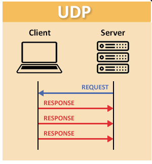

<h1> Ft_IRC </h1>

<h2>Protocols internet:</h2>

<h3>Stream Sockets (TCP):</h3>

<h5>Datagram Sockets( TCP) (Transmission Control Protocol) - est un protocole fondamental de la couche transport des réseaux informatiques. Il garantit une transmission fiable, ordonnée et sans erreur des données entre des applications connectées à Internet, fonctionnant de concert avec le protocole IP.Fonctionnement principalMode connecté : Une liaison est établie entre l'émetteur et le récepteur avant tout échange de données.Poignée de main (HANDSCHAKE) en trois étapes (3-way handshake) : La connexion s'initialise via l'envoi successif de signaux SYN, SYN-ACK et ACK.Fiabilité : Chaque paquet envoyé possède un numéro de séquence et nécessite un accusé de réception (ACK).Correction des pertes : Si un segment est perdu en chemin, TCP le détecte et demande sa retransmission.Contrôle de flux et congestion : Le protocole ajuste dynamiquement la vitesse d'envoi pour éviter de saturer le réseau ou la machine réceptrice. </h5>

[acknowledgment (ACK)](#ack)

[Un paquet SYN-ACK (SYNC ACK)](#synck-ack)

[handshake TCP](#handshake-tcp)

<h3>User Datagram Protocol (UDP):</h3>

	<h5>
		UDP (User Datagram Protocol) - est un protocole de la couche transport (couche 4) des modèles OSI et TCP/IP. Il fonctionne en mode non connecté : il envoie des données (datagrammes) rapidement sans vérifier la liaison, sans accuser réception et sans garantir l'ordre d'arrivée des paquets.Caractéristiques principales d'UDPNon orienté connexion : aucun échange préalable (pas de handshake) n'est requis avant l'envoi.Léger et rapide : l'en-tête fait seulement 8 octets, ce qui réduit la surcharge réseau.Non fiable : pas de retransmission en cas de perte, de duplication ou de désordre des données.
	<h5>

<h3><u>IRC (Internet Relay Chat):</u></h3>

	<h5>Internet Relay Chat (IRC ; en français : « discussion relayée par Internet ») est un protocole de communication textuel sur Internet. Il sert à la communication instantanée principalement sous la forme de discussions en groupe par l’intermédiaire de canaux de discussion, mais il peut aussi être utilisé pour de la communication entre deux personnes seulement. Il peut par ailleurs être utilisé pour faire du transfert de fichier

 

	IRC est un protocole utilisant TCP et de façon optionnelle TLS. Un serveur IRC peut se connecter à d’autres serveurs IRC. Un réseau IRC est un ensemble de serveurs IRC connectés l’un à l’autre relayant si nécessaire les messages, formant ainsi une architecture répartie. L’utilisateur utilise un logiciel client IRC afin de se connecter à un des serveurs du réseau, le choix du serveur étant indifférent.

</h5>

<h5>Programmes de sockets client/serveur : appels de

[sockets](#socket) :

[bloquants](#mode-bloquant-(default-mode)),
[non bloquants](#mode-non-bloquant) et
[asynchrones](#asynchrones)</h5>

<h2><u>Specificite d'IRC</u></h2>

<h5>La plupart des serveurs IRC ne nécessitent pas l’enregistrement par l’intermédiaire d’un compte, l'utilisateur pouvant alors choisir son nickname (surnom) librement tant qu'il est disponible.</h5>

<h3>
	<u>Moyen d'accès:</u>
</h3>

<h5>L'accès d'utilisateur à un réseau IRC se fait historiquement au moyen d'un logiciel dit « Client IRC » aussi appelee ircOp
</h5>

	<h3>
		<u>Channel :</u>
	</h3>

<h5>
	L’élément de base pour communiquer sur un réseau est le canal (channel dans la spécification). Un canal est défini par une liste d’utilisateurs connectés sur celui-ci. En français, un canal est comparable au mot "salon"

 

	Les canaux peuvent être vus de tout le réseau, leur nom est alors préfixé par le caractère croisillon « # » ; ils peuvent aussi être des canaux locaux, portés par un serveur uniquement, leur nom est dans ce cas préfixé par le caractère esperluette « & ».
</h5>

<h3><u>Les Grades</u></h3>

<h5>En IRC, il existe plusieurs grades principaux :</h5>

	Les **Utilisateurs** normaux ne sont marqués avec aucun signe à gauche de leur pseudonyme dans la liste des personnes du salon. Ils n’ont aucun droit sur le salon, sauf celui de parler (si le salon est en -m), ils peuvent t’chatter (même condition). Remarquez que si le salon est en mode -t ils peuvent modifier ou mettre le sujet de salon normalement.
 

	Les **Voices** sont des utilisateurs ayant reçus le mode +v sur un canal de discussion. Ils ne peuvent pas éjecter ou bannir, et n’ont aucun pouvoir sur le salon (comme des utilisateurs normaux). On voice quelqu’un car il peut être ami, personne appréciée.. Cela dépend des salons. Les voices sont en haut de la liste des pseudos (en bas des half-ops) et se font mieux remarquer. Lorsque le salon est en +m, les voices peuvent toujours tchatter (les modérateurs aussi) mais pas les utilisateurs normaux.
 

	Les **Half-Ops**  (Semis-Opérateurs) sont des utilisateurs ayant reçus le mode +h sur un canal de discussion. Ils peuvent changer le sujet du salon (le topic) même lorsque le salon est en +t, et ils peuvent éjecter (kicker) ou bannir (ban) quelqu‘un. Ils peuvent appliquer certains modes sur le salon et mettre les personnes qu’ils veulent voice. Ils peuvent appliquer l’option +e sur des personnes, afin que cette personne ne puisse pas être bannie du salon de t’chat pendant qu’elle a l’option +e sur le salon. Une personne bannie du salon a le mode +b. Pour bannir quelqu‘un du salon , il faut écrire /mode #NOM_DU_SALON +b XXX. Reportez vous au chapitre Bannissements pour savoir avec quoi peut-on remplacer le XXX. Pour voicer quelqu`un, l’half-op doit écrire /mode #NOM_DU_SALON +v XXX en remplaçant XXX par le nom de la personne. à noter que certains réseaux IRC ne disposent pas de ce mode d'utilisateur.
 

	Les **Ops** (Opérateurs du salon), utilisateurs ayant reçus le mode +o sur un canal de discussion, ont les mêmes pouvoirs que les half-ops mais peuvent appliquer certains modes sur le salon que les half-ops ne peuvent pas (salon privé, salon en +l, protection contre le flood, bloquage de messages couleurs etc.).

 

	Les **Admins** sont des utilisateurs ayant reçus le mode +a sur un canal de discussion. Sous unreal IRCd, ce mode est attribué à un utilisateur ayant un acces d'au moins dix sur un canal de discussion. Il peuvent modérer les opérateurs et changer une partie de la configuration d'un canal, retirer ou ajouter des accès inférieur à leur niveau.

 

	L'**Owner** et le **Founder** est un utilisateur ayant reçu le mode +q sur un canal de discussion. L'Owner peut modifier complêtement la configuration du canal de discussion et déléguer son statut d'owner à un autre utilisateur.

<h3><u>Les commandes IRC et leur définition</u></h3>

	
Par exemple, pour rejoindre un canal, un utilisateur doit effectuer

	/join #channelname

	
 C’est l’une des principales commandes, car elle liste toutes les commandes disponibles dans le canal. Pour commencer, elle vous donne une bonne vue d’ensemble de toutes vos options dans l’IRC.

	/help

	
Il est important, tout particulièrement pour les nouveaux venus dans un canal, de s’informer sur les règles en vigueur. Cette commande vous fournit toutes les règles du serveur.

	/rules

	
Grâce à cette commande, vous pouvez changer votre pseudonyme sous lequel vous écrivez avec les autres dans le canal. Néanmoins, cette pratique ne doit pas être trop fréquente afin d’éviter toute confusion inutile.

	/nick <nouveau pseudonyme>&nbsp;: </nouveau>

	
 Si vous voulez inviter une personne spécifique au canal dans lequel vous êtes actuellement, vous pouvez utiliser cette commande. Vous devrez peut-être ajouter « #channelname » à la commande si les membres du canal sont les seuls à être autorisés à inviter d’autres personnes.

	/invite <pseudonyme>&nbsp;</pseudonyme>

	
Si vous souhaitez envoyer un message texte destiné à une seule personne du chat, utilisez cette commande afin d’établir un dialogue privé.

	/msg <pseudonyme>&nbsp;: </pseudonyme>

<h3>
 	<u>

[Les modes](#modes) :

</u>
</h3>
<h5>
	Les modes sont des options positionnées sur des canaux ou des utilisateurs, et qui affectent leur mode de fonctionnement, leurs privilèges et leurs interactions avec les autres entités de l’IRC.
</h5>

[Mode de canal](#different-modes-de-canal)

	<h3>
		<u>Mode bloquant (Default mode)</u>
	</h3>

	<h5>
	Le programme s'arrête complètement et attend que l'action soit terminée avant de continuer. Par exemple, s'il attend une connexion d'un client, rien d'autre ne se passe tant que ce client n'arrive pas. C'est simple à programmer mais ça peut « geler » l'application.
	</h5>

<h5>

	Le problème du mode bloquant : Par défaut, si vous tentez de lire (read/recv) sur une socket classique et qu'aucun message n'est envoyé, le programme s'arrête et attend. Pendant cette attente, le serveur est totalement figé : il ne peut pas traiter les autres utilisateurs, accepter de nouvelles connexions ou relayer les messages des canaux.

	<h3>
		<u>Mode non bloquant</u>
	</h3>

<h5>
	Mode non bloquant ircMode non bloquant ircLe mode non bloquant (ou non-blocking) dans le contexte d'un serveur ou d'un client IRC (Internet Relay Chat) signifie que les opérations d'entrée/sortie (E/S ou I/O) sur les sockets réseau s'exécutent immédiatement sans jamais interrompre ou figer le programme, même si aucune donnée n'est prête à être l'ue ou écrite.Cette architecture est indispensable pour qu'un serveur IRC puisse gérer des milliers de connexions simultanées de manière fluide.

 

	Pourquoi le non-bloquant est indispensable en IRC :

	En configurant les sockets en non-bloquant, les fonctions de lecture et d'écriture renvoient instantanément une erreur spécifique (comme EWOULDBLOCK ou EAGAIN) si l'opération ne peut pas être effectuée immédiatement. Le programme passe alors instantanément à la suite sans perdre de temps.
</h5>

[EWOULDBLOCK](#ewoulblock)
[EAGAIN](#eagain)

	<h3>
		<u>asynchrones</u>
	</h3>

L'IRC asynchrone (ou Asynchronous IRC) désigne l'utilisation du protocole Internet Relay Chat de manière différée, permettant à un utilisateur de lire et d'envoyer des messages sans être connecté en permanence et en temps réel au serveur.Pour transformer ce protocole initialement synchrone en un outil de communication asynchrone (similaire à Slack, Discord ou Matrix), plusieurs méthodes et outils sont utilisés :

[Les Bouncers IRC (BNC)](#bouncers)

[Les clients IRC modernes et d'architecture Client-Serveur](#clients-irc)

[Les passerelles (Bridges) vers des protocoles asynchrones](#protocoles-asynchrones)

 
 
 
 
 
 

	<h3>
		<u>Vocabulaire</u>
	</h3>

<h5>
	- modes :
  </h5>
	Les modes sont des options positionnées sur des canaux ou des utilisateurs, et qui affectent leur mode de fonctionnement, leurs privilèges et leurs interactions avec les autres entités de l’IRC.

<h5>
	- socket :
  </h5>  Dans le contexte des logiciels, on peut le traduire par « connecteur réseau » ou « interface de connexion »

   

		Socket réseau (Logiciel)

		Définition : Un point de terminaison virtuel qui permet à deux programmes d'échanger des données sur un même ordinateur ou à travers un réseau (comme Internet).

		Socket processeur (Matériel)

		Définition : Le support physique carré situé sur la carte mère d'un ordinateur qui accueille le processeur (CPU).
		Rôle : Il assure la liaison électrique et mécanique entre le processeur et les autres composants du système, évitant ainsi d'avoir à le souder directement.
		Exemple : Les formats LGA (avec broches sur la carte mère) et PGA (avec broches sur le processeur).

Exemple : Votre navigateur web utilise des sockets pour dialoguer avec les serveurs des sites que vous visitez.

		Fonctionnement :

		La communication par socket est souvent comparée aux communications humaines. On distingue ainsi deux modes de communication :

		le mode connecté (comparable à une communication téléphonique), utilisant le protocole TCP. Dans ce mode de communication, une connexion durable est établie entre les deux processus, de telle façon que l’adresse de destination n’est pas nécessaire à chaque envoi de données ;

		le mode non connecté (analogue à une communication par courrier), utilisant le protocole UDP. Ce mode nécessite l’adresse de destination à chaque envoi, et aucun accusé de réception n’est donné.
		Les sockets sont implémentés dans différents langages (C, Java, ...) . En langage C, ils utilisent des fonctions et des structures disponibles dans la bibliothèque <sys/socket.h>.

<h5>
	 - RFC (Request for comments) :
 </h5>
 	Les Requests for comments (RFC), littéralement « demandes de commentaires », sont une série numérotée de documents décrivant les aspects et spécifications techniques d'Internet, ou de différents matériels informatiques (routeurs, serveur DHCP). Peu de RFC sont des standards, mais tous les documents publiés par l'IETF sont des RFC.
  </h5>

<h5> - DHCP (Dynamic Host Configuration Protocol)</h5> DHCP, protocole de configuration dynamique des hôtes est un protocole réseau dont le rôle est d’assurer la configuration automatique des paramètres IP d’une station ou d'une machine, notamment en lui attribuant automatiquement une adresse IP et un masque de sous-réseau. DHCP peut aussi configurer l’adresse de la passerelle par défaut et configurer des serveurs de noms comme DNS ou NBNS

<h5>- IP</h5>
	internet Protocol (littéralement protocole Internet, abrégé en IP) est une famille de protocoles de communication de réseaux informatiques conçus pour être utilisés sur Internet. Les protocoles IP sont au niveau 3 dans le modèle OSI. Les protocoles IP s'intègrent dans la suite des protocoles Internet et permettent un service d'adressage unique pour l'ensemble des terminaux connectés.

<h5>- Internet</h5>
	Internet est le réseau informatique mondial accessible au public.Il est constitué de millions de réseaux tant publics que privés, universitaires, commerciaux et gouvernementaux, à commutation de paquets, sans centre névralgique. Ceux-ci sont regroupés en réseaux autonomes. Il existe plus de 91 000 réseaux distincts en 2019[1].Les données échangées sont retransmises par Internet grâce à un ensemble standardisé de protocoles de transfert de données, lesquels permettent différentes applications comme le courrier électronique, le World Wide Web, la messagerie instantanée, le partage de fichiers en pair-à-pair, le streaming, etc.

<h5>- WWW (World Wide Web)</h5>
	Le World Wide Web (/ˌwɜːld waɪd ˈweb/[a]), abrégé en WWW, W3, le Web, la toile mondiale ou simplement la toile[1], est un système hypertexte public fonctionnant sur Internet. Le Web permet de consulter, à l'aide d'un navigateur, des pages regroupées en sites. Web signifie littéralement « toile (d’araignée) », image représentant les hyperliens qui lient les pages web entre elles[b].Le Web est une des applications d'Internet[2], qui est distincte d'autres applications comme les réseaux sociaux, le courrier électronique et la visioconférence. Inventé en 1989-1990 au CERN par Tim Berners-Lee épaulé de Robert Cailliau, le Web popularise Internet[3]. Depuis, il est fréquemment confondu avec ce dernier[4].
</h5>

 <h5> - client IRC </h5>
	permet de se connecter à un serveur pour discuter en direct par texte sur le réseau IRC (Internet Relay Chat). Il sert à échanger des messages de groupe dans des salons ou en privé, et à partager des fichiers.

<h5> - bouncers</h5>
	Un BNC est un proxy applicatif qui reste connecté à un serveur IRC 24h/24 à votre place.Persistance : Lorsque vous fermez votre client IRC, le BNC reste en ligne et accumule les messages manqués.Rattrapage : À votre reconnexion, le BNC vous rejoue l'historique des discussions (le buffer).Logiciels populaires : ZNC (le plus connu) ou Sozu.

<h5> - clients-irc</h5>
	Certains outils récents intègrent nativement cette logique asynchrone sans nécessiter de configurer un BNC séparé.Quassel IRC : Sépare l'application en deux parties (un cœur qui reste connecté sur un serveur distant et un client graphique pour l'utilisateur).The Lounge : Un client IRC web auto-hébergeable qui gère l'historique et reste connecté en permanence en arrière-plan.

<h5>- protocoles asynchrones</h5>
	Il est fréquent de coupler IRC à des réseaux modernes nativement asynchrones.Matrix : Utilise des ponts applicatifs robustes permettant de lire et répondre à des salons IRC depuis un client Matrix (comme Element) avec un historique persistant et des notifications hors-ligne.Souhaitez-vous :Un guide de configuration pour installer un bouncer comme ZNC ?Des recommandations de clients IRC modernes clés en main ?Des explications sur le pontage entre IRC et Matrix ?
<h5> -DCC :</h5>
	Alors que les utilisateurs d'un même réseau IRC reçoivent les messages d'une personne, après que ceux-ci sont passés par un ou plusieurs serveurs, le protocole DCC permet d'établir une connexion directe entre utilisateurs.
	Cette méthode est plus communément utilisée pour envoyer des fichiers, mais peut également être utilisée pour chatter plus rapidement et de manière plus sécurisée avec un autre utilisateur.

<h5> - Robots IRC :</h5>
	Les robots IRC ou bots IRC sont des programmes exécutés depuis des serveurs ou des ordinateurs permettant de faire des actions automatiquement sur un canal IRC.

<h5> - Protocole de communication</h5>
	Dans les réseaux informatiques et les télécommunications, un protocole de communication est une spécification de plusieurs règles pour un type de communication particulier.

<h5> - Transport Layer Security (TLS)</h5>
	Transport Layer Security (TLS) ou « Sécurité de la couche de transport », et son prédécesseur Secure Sockets Layer (SSL) ou « Couche de sockets sécurisée »[1], sont des protocoles de sécurisation des échanges par réseau informatique, notamment par Internet. Le protocole SSL a été développé à l'origine par Netscape Communications Corporation pour son navigateur Web. L'organisme de normalisation Internet Engineering Task Force (IETF) en a poursuivi le développement en le rebaptisant Transport Layer Security (TLS). On parle parfois de SSL/TLS pour désigner indifféremment SSL ou TLS.

 

	- l'authentification du serveur

	- la confidentialité des données échangées (ou session chiffrée)

	- l'intégrité des données échangées

	- de manière optionnelle, l'authentification du client (mais dans la réalité celle-ci est souvent assurée par la couche applicative).

<b>
- ack
</b>
	ACK (pour acknowledgment) est un accusé de réception informatique qui confirme la bonne réception d'un signal ou d'un paquet de données

<b>
- synck-ack
</b>
	Un paquet SYN-ACK (Synchronize-Acknowledgment) est la deuxième étape de la poignée de main en trois temps (three-way handshake) du protocole TCP. Il est envoyé par le serveur en réponse au paquet initial SYN du client pour accuser réception de la demande de connexion et indiquer qu'il est prêt à communiquer.

<b>
- Handshake TCP
</b>
	Le handshake TCP (ou poignée de main en trois temps) est la méthode utilisée par le protocole TCP pour créer un lien sûr et stable entre deux machines avant de transférer des données.Les 3 étapesSYN : Le client envoie un message avec le drapeau SYN pour demander une liaison.SYN-ACK : Le serveur répond avec SYN-ACK pour valider et donner son accord.ACK : Le client envoie ACK pour confirmer la liaison.

<b>
- EAGAIN
</b>
	EAGAIN (« Resource temporarily unavailable ») est un code d'erreur système (errno 11 sur les systèmes type Unix) qui signifie qu'une ressource est momentanément occupée et que l'opération demandée aurait provoqué un blocage. Ce n'est pas une erreur fatale ; elle indique simplement qu'il faut réessayer plus tard.

		Contextes d'apparition E/S non bloquantes :

		Lors d'un appel read() ou write() sur un socket ou un fichier configuré en mode non bloquant (O_NONBLOCK), si aucune donnée n'est prête à être lue ou si le tampon d'écriture est plein.Limites système : Lorsque le système atteint une limite de ressources, comme le nombre maximal de processus ou de threads autorisés lors d'un fork().Délais d'attente : Si un délai de temporisation (timeout) expire sur une opération avant que les données n'arrivent.

		Bonnes pratiques de gestion

		Réessayer :
			Intercepter l'erreur et relancer l'appel système après un court délai ou via une boucle d'attente active contrôlée.

		Multiplexage :
			Utiliser des fonctions comme select() ou poll() pour s'assurer qu'un descripteur de fichier est prêt avant de relancer l'opération.

		Compatibilité :
			Noter que EAGAIN a souvent la même valeur numérique que EWOULDBLOCK sur de nombreux systèmes, mais qu'il est recommandé de tester les deux par portabilité.

<b>
- EWOULDBLOCK
</b>

	Fonctionnement et contexteMode non bloquant :
		 Signale que le processus ne doit pas s'endormir (bloquer) en attendant une ressource indisponible, mais reprendre la main immédiatement.

	Relation avec EAGAIN : Sur de nombreux systèmes, EWOULDBLOCK et EAGAIN ont la même valeur numérique. Il est recommandé de tester les deux dans le code portable.

	Solutions courantes Attendre l'événement :
		Utiliser des mécanismes de multiplexage comme select, poll ou epoll pour savoir quand le socket redevient disponible en lecture ou en écriture.

	Réessayer plus tard :
		Intercepter le code d'erreur dans la boucle d'événements pour relancer l'opération ultérieurement.

 
 
 
 
 

<h3><u>Different modes de canal
</h3></u>

<u><h5>Mode d'utilisateur</h5></u>

| Lettre | Symbole | Description |
|:--------: |:--------:| :--------:|
| i     |    | Invisible : en dehors de la participation commune à un canal, l'utilisateur n'est pas visible par les autres.    |
| s     |    | Reçoit toutes les notifications du serveur.    |
| w     |    | Reçoit tous les messages envoyés par la commande « wallop ».    |
| o     |    | L'utilisateur est un opérateur IRC (à ne pas confondre avec le mode de canal « o »).    |

<u><h5>Modes de canal</h5></u>

| Lettre | Lettre | Paramètre | Description |
|:--------: |:--------:| :--------:| :--------:|
| o     | @   | nom de l'utilisateur concerné    | Opérateur de canal : peut changer les modes du canal et expulser les autres utilisateurs.    |
| a     | & / @   | nom de l'utilisateur concerné    | ChanMaster : peut changer les modes du canal poser des ban permanents et expulser les utilisateurs.    |
| q     | ~ / @   | nom de l'utilisateur concerné    | Owner : propriétaire d'un canal à un accès complet sur le canal.    |
| h     | %   | nom de l'utilisateur concerné    | Halfop : a un accès limité aux commandes, voice et devoice les utilisateurs, expulser et bannir des utilisateurs sur une courte durée.    |
| v     | +   | nom de l'utilisateur concerné    | Verbose ou Voiced : autorise l'utilisateur à parler sur un canal modéré (mode « +m »).    |
| s     |    |     | Canal secret ; le canal est totalement invisible.    |
| p     |    |     | Canal privé; le nom du canal est invisible.    |
| n     |    |     | Les messages externes ne sont pas autorisés.    |
| m     |    |     | Canal modéré, seuls les utilisateurs en mode « +v » et les opérateurs peuvent envoyer un message.    |
| i     |    |     | Canal accessible uniquement sur invitation (commande « /invite »).    |
| t     |    |     | Sujet du canal uniquement modifiable par les opérateurs du canal.    |
| l     |    |limite| Fixe la limite du nombre d'utilisateurs sur le canal à « limite ».    |
| b     |    |utilisateur| Bannit l'utilisateur « utilisateur ».    |
| k     |    |clef| Seuls les utilisateurs connaissant la clé « clef » pourront se connecter au canal.    |

 
 
 
 

<h1><u>Questions et reponses :</u></h1>

Qu'est-ce que l'Internet Relay Chat (IRC) ?

	IRC est un moyen de messagerie en temps réel sur l'internet. Il permet à des groupes ou à deux personnes de parler instantanément. Créé en 1988, il connecte les utilisateurs par le biais d'un réseau utilisant différents clients logiciels.

Comment choisir le bon client IRC ?

	Le choix d'un client IRC dépend de votre appareil et de vos préférences. Pour Windows, HexChat est une solution de choix, tandis que les utilisateurs de macOS choisissent souvent Textual. Les systèmes UNIX s'accordent bien avec irssi. Examinez leurs fonctionnalités, leur aspect et leur convivialité, ainsi que leur support lors de votre choix.

Comment se connecter à un réseau IRC ?

	Tout d'abord, installez votre client IRC. Ensuite, vous pouvez vous connecter en tapant /connect suivi de l'adresse du serveur. Vous pouvez également choisir un réseau directement dans la liste de votre client.

Comment enregistrer un pseudo sur IRC ?

	Commencez par choisir un nom unique avec /nick. Ensuite, enregistrez-le en utilisant /msg NickServ register [password] [email]. Les différents réseaux peuvent avoir d'autres étapes, vérifiez donc leurs directives.

Quelle est la commande pour rejoindre un canal IRC ?

	Pour rejoindre un canal, tapez /join puis le nom du canal. Cette commande peut également créer un nouveau canal s'il n'existe pas et si les paramètres du réseau le permettent.

Puis-je avoir des conversations privées sur IRC ?

	Oui, les chats privés sont possibles sur IRC. Utilisez /msg ou /query, en ajoutant le pseudo de la personne. Cela permet de démarrer une discussion en tête-à-tête avec la personne dans une nouvelle fenêtre ou un nouvel onglet.

Comment les opérateurs de canaux gèrent-ils leurs canaux ?

	Les opérateurs gèrent les canaux en définissant les modes avec /mode et en modifiant les autorisations des utilisateurs avec des commandes telles que /op et /kick. Ils s'assurent que les chats respectent le thème et les règles du canal.

Quelles sont les commandes IRC avancées ?

	Pour les utilisateurs avancés, des commandes comme /wallops, /notice et /links sont utiles. Elles vous permettent d'envoyer des messages aux opérateurs, des messages non privés aux utilisateurs et de consulter la liste des serveurs. La maîtrise de ces commandes peut améliorer votre expérience de l'IRC.

Comment créer et gérer mon propre canal IRC ?

	Créez un canal avec /join #newchannelname ; vous serez l'opérateur si vous êtes le premier. Gérez-le en définissant des sujets avec /topic, en changeant de mode avec /mode et en contrôlant l'accès. Veillez à respecter les règles du réseau.

Comment puis-je sécuriser mon expérience de l'IRC ?

	Pour une expérience sécurisée, utilisez des connexions SSL et cachez votre IP avec des modes d'utilisation. Enregistrez votre pseudonyme. Faites attention aux fichiers que vous partagez. Utilisez NickServ et ChanServ pour vous protéger contre les abus et les interférences.

Quelle est la syntaxe des commandes IRC ?

	Les commandes IRC commencent par une barre oblique (/). Pour un nouveau pseudo, tapez /nick NouveauNom. Pour quitter un canal, c'est /part #channelname. Ces notions de base vous aideront à naviguer sur IRC.

 
 
 
 
 

<u>
SOURCES :
</u>

https://www.youtube.com/watch?v=D26sUZ6DHNQ
