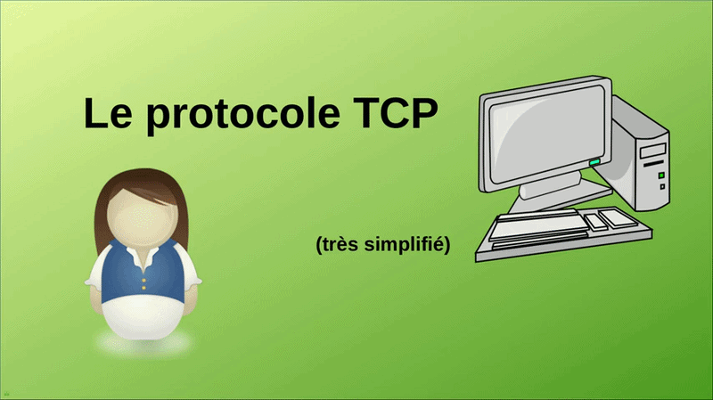
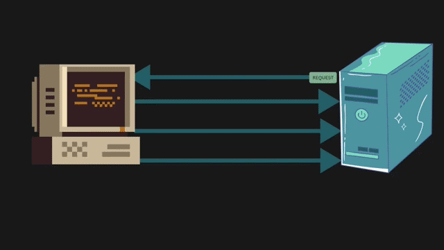
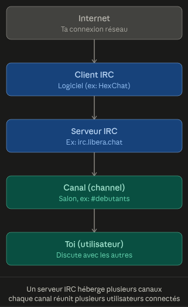

<h1> Ft_IRC </h1>

<h3>Protocols internet:</h3>

<h3>Stream Sockets (TCP):</h3>

<h5>Datagram Sockets( TCP) (Transmission Control Protocol) - est un protocole fondamental de la couche transport des réseaux informatiques. Il garantit une transmission fiable, ordonnée et sans erreur des données entre des applications connectées à Internet, fonctionnant de concert avec le protocole IP.Fonctionnement principalMode connecté : Une liaison est établie entre l'émetteur et le récepteur avant tout échange de données.Poignée de main en trois étapes (3-way handshake) : La connexion s'initialise via l'envoi successif de signaux SYN, SYN-ACK et ACK.Fiabilité : Chaque paquet envoyé possède un numéro de séquence et nécessite un accusé de réception (ACK).Correction des pertes : Si un segment est perdu en chemin, TCP le détecte et demande sa retransmission.Contrôle de flux et congestion : Le protocole ajuste dynamiquement la vitesse d'envoi pour éviter de saturer le réseau ou la machine réceptrice.* </h5>

<h3>UDP:</h3>

	<h5>UDP (User Datagram Protocol) - est un protocole de la couche transport (couche 4) des modèles OSI et TCP/IP. Il fonctionne en mode non connecté : il envoie des données (datagrammes) rapidement sans vérifier la liaison, sans accuser réception et sans garantir l'ordre d'arrivée des paquets.Caractéristiques principales d'UDPNon orienté connexion : aucun échange préalable (pas de handshake) n'est requis avant l'envoi.Léger et rapide : l'en-tête fait seulement 8 octets, ce qui réduit la surcharge réseau.Non fiable : pas de retransmission en cas de perte, de duplication ou de désordre des données.*
	<h5>

<h3>IRC (Internet Relay Chat):</h3>

	<h5>Internet Relay Chat (IRC ; en français : « discussion relayée par Internet ») est un protocole de communication textuel sur Internet. Il sert à la communication instantanée principalement sous la forme de discussions en groupe par l’intermédiaire de canaux de discussion, mais il peut aussi être utilisé pour de la communication entre deux personnes seulement. Il peut par ailleurs être utilisé pour faire du transfert de fichier

	Par construction IRC utilise le protocol TCP (sans perte de donnees) pour communiquer entre plusieurs clients de tel sorte que :

</h5>

<h5>Programmes de sockets client/serveur : appels de sockets bloquants, non bloquants et asynchrones</h5>

<h3>Moyen d'accès:</h3>
<h5>L'accès d'utilisateur à un réseau IRC se fait historiquement au moyen d'un logiciel dit « Client IRC ».</h5>

	<h3>
	Mode bloquant (Default mode)
	</h3>

<h2>Le programme s'arrête complètement et attend que l'action soit terminée avant de continuer. Par exemple, s'il attend une connexion d'un client, rien d'autre ne se passe tant que ce client n'arrive pas. C'est simple à programmer mais ça peut « geler » l'application.</h2>

	<h3>
	Mode non bloquant
	</h3>

<h3>Vocabulaire</h3>

- <h5>modes :</h5> Les modes sont des options positionnées sur des canaux ou des utilisateurs, et qui affectent leur mode de fonctionnement, leurs privilèges et leurs interactions avec les autres entités de l’IRC.

- <h5>socket :</h5>  une connexion réseau

- <h5>RFC (Request for comments) :</h5>

