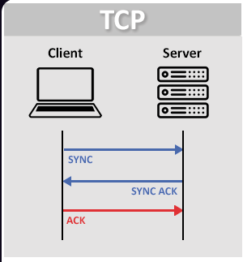

## Stream Sockets (TCP):

[REVENIR AU SOMMAIRE](README.md)

</h3>


Datagram [Sockets](../socket/README.md) [(TCP) (Transmission Control Protocol)](TCP.md) est un [protocole](protocole-comm.md) fondamental de la [couche transport des réseaux informatiques](couche-transport.md).

Il garantit une transmission fiable, ordonnée et sans erreur des données entre des applications connectées à Internet, fonctionnant de concert avec le protocole IP.

Fonctionnement principal:
- Mode connecté : Une liaison est établie entre l'émetteur et le récepteur avant tout échange de données.
- Poignée de main ([Handshake](handshake.md)) en trois étapes ([3-way handshake (TCP handshake)](3-Way%20Handshake.md)) : La connexion s'initialise via l'envoi successif de signaux

	- [SYN](SYN.md)
	- [SYN ACK](SYN-ACK.md)
	- et enfin [ACK](ACK.md).

- Fiabilité :
	- Chaque [paquet](paquets.md) envoyé possède un numéro de séquence et nécessite un accusé de réception ([ACK](ACK.md)).
	- Correction des pertes : Si un segment est perdu en chemin, TCP le détecte et demande sa retransmission.
	- Contrôle de flux et congestion : Le protocole ajuste dynamiquement la vitesse d'envoi pour éviter de saturer le réseau ou la machine réceptrice.




---

# Fermeture TCP

TCP possède également un mécanisme de fermeture de connexion.

Une fermeture classique utilise notamment :

```text
FIN
ACK
FIN
ACK
```

Exemple :

```text
Client                         Serveur

   FIN ───────────────────────►

       ◄──────────────────── ACK

       ◄──────────────────── FIN

   ACK ───────────────────────►
```

TCP permet ainsi aux deux directions de la communication d'être fermées proprement.

---

