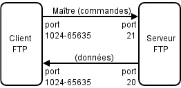
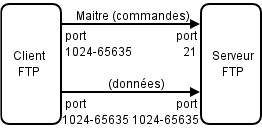

# 📁 Transfert de fichiers

[REVENIR AU SOMMAIRE](README.md)

Le **transfert de fichiers** consiste à déplacer ou copier des fichiers d'une machine vers une autre à travers un réseau.

Il peut se faire entre :

```text
Ordinateur → Ordinateur
Ordinateur → Serveur
Serveur → Serveur
Client → Serveur
Serveur → Client
Client → Client
```

Pour effectuer ces transferts, on utilise des **protocoles** et des logiciels adaptés.

Parmi les protocoles les plus connus :

* **FTP** (*File Transfer Protocol*)
* **SCP** (*Secure Copy Protocol*)
* **SFTP** (*SSH File Transfer Protocol*)

Ces protocoles peuvent être utilisés sur différents types de réseaux, notamment sur un réseau local ou sur Internet.

---

# 📑 Sommaire

1. [FTP](#1-ftp--file-transfer-protocol)
2. [Fonctionnement de FTP](#2-fonctionnement-de-ftp)
3. [Mode actif](#3-mode-actif)
4. [Mode passif](#4-mode-passif)
5. [SCP](#5-scp--secure-copy-protocol)
6. [SFTP](#6-sftp--ssh-file-transfer-protocol)
7. [FTP vs SCP vs SFTP](#7-ftp-vs-scp-vs-sftp)
8. [Utilisation](#8-utilisation)
9. [Résumé](#9-résumé)

---

# 1. FTP — File Transfer Protocol

**FTP** signifie :

```text
File Transfer Protocol
```

C'est l'un des protocoles historiques utilisés pour transférer des fichiers sur un réseau.

FTP a été conçu au début des années 1970 et fait partie des protocoles les plus anciens encore rencontrés.

---

## Principe

FTP permet à un client de se connecter à un serveur afin de :

* envoyer des fichiers ;
* télécharger des fichiers ;
* lister des fichiers ;
* créer des dossiers ;
* supprimer des fichiers ;
* déplacer des fichiers ;
* gérer des répertoires.

Schéma général :

```text
┌──────────────┐
│ FTP Client   │
└──────┬───────┘
       │
       │ FTP
       ▼
┌──────────────┐
│ FTP Server   │
└──────────────┘
```

---

## Sécurité

FTP classique **ne chiffre pas les communications**.

Les informations peuvent donc circuler en clair :

```text
Identifiant
Mot de passe
Commandes
Données
Fichiers
```

Conceptuellement :

```text
Client
  │
  │ USER bob
  │ PASS password
  │
  │ Fichier
  ▼
Serveur
```

Sans chiffrement, une personne capable d'observer le trafic peut potentiellement récupérer ces informations.

Un outil d'analyse réseau comme Wireshark peut permettre d'observer le trafic non chiffré.

> **FTP classique = transfert de fichiers sans chiffrement.**

---

# 2. Fonctionnement de FTP

FTP utilise **deux connexions distinctes** :

```text
Connexion de contrôle
        +
Connexion de données
```

La connexion de contrôle est généralement établie sur :

```text
Port 21
```

Elle sert notamment à transmettre les commandes.

Exemple :

```text
USER
PASS
LIST
RETR
STOR
QUIT
```

La connexion de données est utilisée pour transférer les fichiers ou les listes de répertoires.

```text
              FTP CLIENT
                  │
        ┌─────────┴─────────┐
        │                   │
        ▼                   ▼
   Contrôle              Données
   Port 21             Autre port
        │                   │
        └─────────┬─────────┘
                  ▼
              FTP SERVER
```

Cette séparation entre contrôle et données explique notamment pourquoi la configuration de FTP peut être plus complexe avec certains pare-feux.

---

# 3. Mode actif

En **mode actif**, le serveur établit la connexion de données vers le client.

Schéma simplifié :



Le client indique au serveur sur quel port il doit établir la connexion de données.

Le serveur initie ensuite cette connexion.

---

## Problème avec les pare-feux

Le mode actif peut être problématique lorsque le client se trouve derrière :

* un pare-feu ;
* un routeur ;
* un NAT.

Le serveur doit pouvoir établir une connexion vers le client, ce qui peut être bloqué.

```text
FTP Server
    │
    │ Connexion entrante
    ▼
┌───────────┐
│ Firewall  │
└─────┬─────┘
      X
   bloqué
      │
      ▼
   Client
```

---

# 4. Mode passif

En **mode passif**, c'est le client qui établit également la connexion de données.



Le serveur indique au client un port sur lequel il attend la connexion.

Le client établit ensuite cette connexion.

---

## Pourquoi utiliser le mode passif ?

Le mode passif fonctionne généralement mieux avec :

```text
Client
  │
  ▼
NAT / Routeur
  │
  ▼
Internet
  │
  ▼
Serveur FTP
```

Le client étant généralement autorisé à effectuer des connexions sortantes, cette configuration est plus adaptée aux réseaux modernes.

---

## Comparaison

```text
Mode actif

Client ───────────────► Serveur
       contrôle

Serveur ──────────────► Client
       données
```

```text
Mode passif

Client ───────────────► Serveur
       contrôle

Client ───────────────► Serveur
       données
```

---

# 5. SCP — Secure Copy Protocol

**SCP** signifie :

```text
Secure Copy Protocol
```

SCP permet de copier des fichiers entre deux machines en utilisant **SSH**.

Il est principalement conçu pour effectuer des copies de fichiers de manière sécurisée.

```text
Client
  │
  │ SSH / SCP
  │
  ▼
Serveur
```

---

## Sécurité

Contrairement au FTP classique, les communications SCP sont protégées par SSH.

Les données échangées sont chiffrées.

Cela protège notamment :

```text
Identifiants
Données
Fichiers
Commandes
```

Le port SSH utilisé par défaut est :

```text
22
```

---

## Utilisation

SCP est particulièrement pratique pour copier rapidement un fichier.

Exemple :

```bash
scp fichier.txt user@serveur:/home/user/
```

Pour copier un fichier du serveur vers la machine locale :

```bash
scp user@serveur:/home/user/fichier.txt .
```

Pour copier un dossier :

```bash
scp -r dossier/ user@serveur:/home/user/
```

---

## Limites

SCP est principalement destiné à la copie.

Il ne fournit pas la même expérience interactive qu'un protocole de gestion de fichiers comme SFTP.

Il est notamment moins adapté lorsqu'on souhaite :

* naviguer dans les dossiers ;
* manipuler les fichiers interactivement ;
* gérer de nombreux fichiers ;
* reprendre facilement des transferts interrompus.

---

# 6. SFTP — SSH File Transfer Protocol

**SFTP** signifie :

```text
SSH File Transfer Protocol
```

Malgré son nom, SFTP n'est **pas une version sécurisée de FTP**.

SFTP est un protocole distinct qui fonctionne au-dessus de SSH.

```text
SFTP
  │
  ▼
SSH
  │
  ▼
Connexion sécurisée
```

Il utilise généralement :

```text
Port 22
```

---

## Sécurité

SFTP chiffre les échanges grâce à SSH.

Les données transférées sont donc protégées contre l'écoute du trafic.

```text
Client
  │
  │ 🔒 SFTP / SSH
  │
  ▼
Serveur
```

---

## Fonctionnement

Contrairement à SCP, SFTP fournit une interface permettant de manipuler les fichiers sur le serveur.

On peut notamment :

```text
Lister
Naviguer
Envoyer
Télécharger
Supprimer
Renommer
Créer des dossiers
```

Exemple :

```bash
sftp user@serveur
```

Une fois connecté :

```text
sftp> ls
sftp> cd documents
sftp> put fichier.txt
sftp> get image.jpg
sftp> mkdir backup
sftp> rm ancien.txt
```

---

## Reprise d'un transfert

SFTP peut également permettre de reprendre un transfert interrompu.

Exemple :

```text
Fichier de 2 Go

████████████████░░░░░░░░

             ↓ coupure

████████████████░░░░░░░░
```

Le transfert peut être repris sans nécessairement recommencer depuis le début.

---

# 7. FTP vs SCP vs SFTP

| Caractéristique               |           FTP          |   SCP   | SFTP |
| ----------------------------- | :--------------------: | :-----: | :--: |
| Chiffrement                   |            ❌           |    ✅    |   ✅  |
| Basé sur SSH                  |            ❌           |    ✅    |   ✅  |
| Port par défaut               |           21           |    22   |  22  |
| Connexion de contrôle séparée |            ✅           |    ❌    |   ❌  |
| Connexion de données séparée  |            ✅           |    ❌    |   ❌  |
| Navigation interactive        |            ✅           |    ❌    |   ✅  |
| Envoi de fichiers             |            ✅           |    ✅    |   ✅  |
| Téléchargement                |            ✅           |    ✅    |   ✅  |
| Création de dossiers          |            ✅           |  Limité |   ✅  |
| Suppression de fichiers       |            ✅           |  Limité |   ✅  |
| Reprise de transfert          | Selon client/protocole | Limitée |   ✅  |

---

# 8. Utilisation

## FTP

Client FTP :

```bash
ftp serveur
```

Exemple :

```bash
ftp 192.168.1.10
```

Une fois connecté :

```text
ftp> ls
ftp> cd documents
ftp> get fichier.txt
ftp> put fichier.txt
ftp> quit
```

FTP peut également être utilisé avec des logiciels graphiques.

---

## SCP

Copier vers un serveur :

```bash
scp fichier.txt user@serveur:/home/user/
```

Télécharger depuis un serveur :

```bash
scp user@serveur:/home/user/fichier.txt .
```

Copier un dossier :

```bash
scp -r dossier user@serveur:/home/user/
```

---

## SFTP

Connexion :

```bash
sftp user@serveur
```

Commandes courantes :

```text
ls
cd
pwd
get
put
mkdir
rm
rename
quit
```

Exemple :

```text
sftp> ls
sftp> cd documents
sftp> put fichier.txt
sftp> get image.jpg
sftp> quit
```

---

# 9. Résumé

Le transfert de fichiers peut être réalisé avec différents protocoles.

```text
                 TRANSFERT DE FICHIERS
                         │
          ┌──────────────┼──────────────┐
          │              │              │
          ▼              ▼              ▼
         FTP            SCP            SFTP
          │              │              │
          │              │              │
      Non chiffré     SSH / chiffré   SSH / chiffré
          │              │              │
      Port 21        Port 22        Port 22
```

### FTP

```text
FTP
│
├── Ancien
├── Non chiffré
├── Port 21
├── Contrôle + données
├── Mode actif
└── Mode passif
```

### SCP

```text
SCP
│
├── Copie de fichiers
├── Basé sur SSH
├── Chiffré
└── Port 22
```

### SFTP

```text
SFTP
│
├── Protocole distinct de FTP
├── Fonctionne avec SSH
├── Chiffré
├── Port 22
├── Navigation
├── Gestion de fichiers
└── Reprise de transferts
```

Pour retenir simplement :

```text
FTP  → transfert classique, mais non chiffré
SCP  → copie rapide et sécurisée
SFTP → gestion complète et sécurisée des fichiers
```
