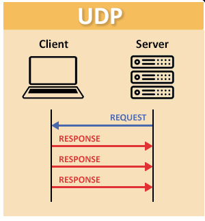

# UDP — User Datagram Protocol

[REVENIR AU SOMMAIRE](README.md)

UDP (*User Datagram Protocol*) est un protocole de la **couche transport**, soit la couche 4 du modèle OSI.

Il permet à une application d'envoyer des données sous forme de **datagrammes**, sans établir de connexion préalable avec le destinataire.

UDP privilégie la **simplicité**, le **faible overhead** et la **rapidité d'envoi**, au détriment de certaines garanties fournies par d'autres protocoles.



---

# 📑 Sommaire

1. [Qu'est-ce que UDP ?](#1-quest-ce-que-udp)
2. [Caractéristiques](#2-caractéristiques)
3. [Datagramme UDP](#3-datagramme-udp)
4. [En-tête UDP](#4-en-tête-udp)
5. [Ports](#5-ports)
6. [Communication UDP](#6-communication-udp)
7. [UDP côté serveur](#7-udp-côté-serveur)
8. [UDP côté client](#8-udp-côté-client)
9. [sendto() et recvfrom()](#9-sendto-et-recvfrom)
10. [Perte de données](#10-perte-de-données)
11. [Ordre des données](#11-ordre-des-données)
12. [Taille des datagrammes](#12-taille-des-datagrammes)
13. [Avantages et inconvénients](#13-avantages-et-inconvénients)
14. [UDP en C/C++](#14-udp-en-cc)
15. [Résumé](#15-résumé)

---

# 1. Qu'est-ce que UDP ?

UDP signifie :

```text
User Datagram Protocol
```

C'est un protocole de transport **sans connexion**.

Contrairement à un protocole orienté connexion, UDP ne nécessite pas d'établir une connexion avant d'envoyer les données.

```text
Client                         Serveur

DATA ────────────────────────►
DATA ────────────────────────►
DATA ────────────────────────►
```

Le client peut envoyer directement un datagramme au destinataire.

Il n'y a pas de phase obligatoire d'établissement de connexion.

---

# 2. Caractéristiques

UDP possède plusieurs caractéristiques importantes.

## Sans connexion

UDP ne crée pas de connexion avant l'envoi.

```text
Application
    │
    ▼
   UDP
    │
    ▼
Envoi
```

Il n'existe pas de procédure d'établissement de connexion équivalente à un handshake.

---

## Pas de garantie de livraison

UDP ne garantit pas que le datagramme arrivera à destination.

```text
Émetteur                    Récepteur

DATA ──────────────── X
                       perdu
```

Le protocole ne demande pas automatiquement une retransmission.

---

## Pas de garantie d'ordre

Si plusieurs datagrammes sont envoyés :

```text
DATA 1
DATA 2
DATA 3
```

ils peuvent être reçus dans un ordre différent :

```text
DATA 2
DATA 1
DATA 3
```

UDP ne réorganise pas automatiquement les données.

---

## Pas de retransmission native

Si un datagramme est perdu :

```text
DATA ───────── X
```

UDP ne le renvoie pas automatiquement.

Si l'application a besoin de fiabilité, elle doit implémenter elle-même un mécanisme adapté.

---

## Faible overhead

L'en-tête UDP est très petit :

```text
8 octets
```

Cela permet de garder le protocole simple.

---

# 3. Datagramme UDP

L'unité de données UDP est appelée **datagramme**.

Un datagramme contient :

```text
┌─────────────────────────────┐
│       En-tête UDP           │
├─────────────────────────────┤
│                             │
│          Données            │
│                             │
└─────────────────────────────┘
```

L'en-tête UDP contient les informations nécessaires au protocole.

---

# 4. En-tête UDP

L'en-tête UDP possède une taille fixe de :

```text
8 octets
```

Il contient quatre champs :

```text
┌──────────────────┬──────────────────┐
│  Port source     │ Port destination │
├──────────────────┴──────────────────┤
│             Longueur                │
├─────────────────────────────────────┤
│             Checksum                │
└─────────────────────────────────────┘
```

---

## Port source

Le port utilisé par l'émetteur.

```text
Port source
```

Il permet notamment au destinataire de savoir vers quel port répondre.

---

## Port destination

Le port sur lequel le destinataire attend les données.

```text
Port destination
```

Exemple :

```text
192.168.1.20:50000
        │
        │ UDP
        ▼
192.168.1.30:4242
```

Ici :

```text
50000 → port source
4242  → port destination
```

---

## Length

Le champ `Length` indique la taille du datagramme UDP.

Il inclut :

```text
En-tête UDP + données
```

---

## Checksum

Le `Checksum` permet de détecter certaines erreurs de transmission.

Il permet au destinataire de vérifier l'intégrité du datagramme.

---

# 5. Ports

UDP utilise des **ports** pour identifier les applications.

Un port est compris entre :

```text
0 → 65535
```

Exemple :

```text
192.168.1.10:50000
```

Le port :

```text
50000
```

identifie l'extrémité UDP utilisée par l'application.

Un serveur UDP peut écouter sur un port précis :

```text
Serveur
   │
   └── UDP : 4242
```

Un client peut alors envoyer un datagramme vers :

```text
Serveur:4242
```

---

# 6. Communication UDP

Une communication UDP peut être représentée simplement :

```text
┌──────────────┐
│   Client     │
└──────┬───────┘
       │
       │ Datagramme UDP
       ▼
┌──────────────┐
│   Serveur    │
└──────────────┘
```

Le client indique notamment :

```text
Adresse destination
Port destination
Données
```

Exemple :

```text
Destination :
192.168.1.20:4242

Données :
"Hello"
```

---

# 7. UDP côté serveur

Un serveur UDP crée une socket et l'associe généralement à une adresse et un port.

Schéma général :

```text
socket()
   ↓
bind()
   ↓
recvfrom()
   ↓
sendto()
```

Contrairement à un serveur utilisant un protocole orienté connexion, il n'y a pas de :

```text
listen()
accept()
```

Le serveur reçoit directement les datagrammes.

---

# 8. UDP côté client

Un client UDP peut créer une socket puis envoyer directement un datagramme.

Schéma général :

```text
socket()
   ↓
sendto()
```

Il n'est pas nécessaire d'établir une connexion avant l'envoi.

```text
Client
   │
   │ socket()
   │
   │ sendto()
   ▼
Serveur
```

---

# 9. sendto() et recvfrom()

Les fonctions couramment utilisées pour UDP sont :

```cpp
sendto()
recvfrom()
```

---

## sendto()

`sendto()` permet d'envoyer un datagramme vers une adresse donnée.

Forme générale :

```cpp
sendto(
    socket_fd,
    buffer,
    length,
    flags,
    destination,
    address_length
);
```

Exemple :

```cpp
const char *msg = "Hello";

sendto(
    sockfd,
    msg,
    5,
    0,
    (struct sockaddr *)&server_addr,
    sizeof(server_addr)
);
```

Le destinataire est indiqué directement dans l'appel.

---

## recvfrom()

`recvfrom()` permet de recevoir un datagramme.

```cpp
recvfrom(
    socket_fd,
    buffer,
    length,
    flags,
    source,
    address_length
);
```

Exemple :

```cpp
char buffer[1024];

recvfrom(
    sockfd,
    buffer,
    sizeof(buffer),
    0,
    (struct sockaddr *)&client_addr,
    &client_len
);
```

La fonction permet également de récupérer l'adresse de l'émetteur.

---

# 10. Perte de données

UDP ne garantit pas la livraison des datagrammes.

Exemple :

```text
Client                         Serveur

DATA 1 ───────────────────────►

DATA 2 ─────────────── X

DATA 3 ───────────────────────►
```

Le serveur peut recevoir :

```text
DATA 1
DATA 3
```

sans jamais recevoir :

```text
DATA 2
```

UDP ne retransmet pas automatiquement `DATA 2`.

Si l'application veut gérer cette situation, elle doit implémenter son propre mécanisme.

Par exemple :

```text
Client                         Serveur

DATA 1 ───────────────────────►
            ◄──────────────── ACK 1

DATA 2 ───────────────────────►
            ◄──────────────── ACK 2
```

Mais ce mécanisme appartient alors à **l'application**, pas à UDP lui-même.

---

# 11. Ordre des données

UDP ne garantit pas l'ordre de réception.

L'application peut envoyer :

```text
DATA 1
DATA 2
DATA 3
```

Le destinataire peut recevoir :

```text
DATA 3
DATA 1
DATA 2
```

UDP ne réorganise pas automatiquement les datagrammes.

Si l'ordre est important, l'application peut ajouter son propre numéro de séquence :

```text
┌──────────────┬─────────────┐
│ Séquence : 1 │ DATA        │
└──────────────┴─────────────┘

┌──────────────┬─────────────┐
│ Séquence : 2 │ DATA        │
└──────────────┴─────────────┘

┌──────────────┬─────────────┐
│ Séquence : 3 │ DATA        │
└──────────────┴─────────────┘
```

Elle pourra alors remettre les données dans le bon ordre.

---

# 12. Taille des datagrammes

UDP conserve les frontières entre les datagrammes.

Si l'application envoie :

```text
"Hello"
```

puis :

```text
"World"
```

il s'agit de deux datagrammes distincts.

```text
Datagramme 1
┌─────────────┐
│   Hello     │
└─────────────┘

Datagramme 2
┌─────────────┐
│   World     │
└─────────────┘
```

Le récepteur reçoit donc des messages séparés.

C'est différent d'un protocole orienté flux où les données sont traitées comme un flux continu d'octets.

---

# 13. Avantages et inconvénients

## Avantages

### Simplicité

UDP possède un fonctionnement très simple.

```text
socket()
   ↓
sendto()
```

---

### Faible overhead

L'en-tête UDP ne fait que :

```text
8 octets
```

---

### Pas de handshake

Il n'y a pas besoin d'établir une connexion avant d'envoyer les données.

---

### Conservation des datagrammes

Chaque envoi correspond à un datagramme distinct.

```text
sendto()
   ↓
Datagramme
```

---

## Inconvénients

UDP ne garantit pas :

```text
❌ Livraison
❌ Ordre
❌ Retransmission
❌ Détection complète des pertes
❌ Contrôle de flux
```

L'application doit donc gérer elle-même ces problèmes si elle en a besoin.

---

# 14. UDP en C/C++

Pour créer une socket UDP IPv4 :

```cpp
int sockfd = socket(AF_INET, SOCK_DGRAM, 0);
```

Les éléments importants sont :

```text
AF_INET
    ↓
IPv4

SOCK_DGRAM
    ↓
Datagrammes

0
    ↓
Protocole UDP par défaut
```

---

## Serveur UDP

Structure générale :

```cpp
int sockfd = socket(AF_INET, SOCK_DGRAM, 0);

bind(sockfd, ...);

recvfrom(sockfd, ...);

sendto(sockfd, ...);
```

Schéma :

```text
socket()
   ↓
bind()
   ↓
recvfrom()
   ↓
sendto()
```

---

## Client UDP

Structure générale :

```cpp
int sockfd = socket(AF_INET, SOCK_DGRAM, 0);

sendto(sockfd, ...);
```

Schéma :

```text
socket()
   ↓
sendto()
```

---

# 15. Résumé

UDP est un protocole de transport **sans connexion** basé sur l'envoi de datagrammes.

```text
Application
     │
     ▼
    UDP
     │
     ▼
   Réseau
```

Son en-tête contient :

```text
Port source
Port destination
Length
Checksum
```

Sa taille minimale d'en-tête est :

```text
8 octets
```

UDP ne garantit pas :

```text
Livraison
Ordre
Retransmission
```

Les fonctions principales en C/C++ sont :

```cpp
socket()
bind()
sendto()
recvfrom()
close()
```

Pour créer une socket UDP :

```cpp
socket(AF_INET, SOCK_DGRAM, 0);
```

Le modèle mental à retenir :

```text
┌──────────────────────────────┐
│         Application          │
├──────────────────────────────┤
│             UDP              │
│                              │
│ Port source                  │
│ Port destination             │
│ Length                       │
│ Checksum                     │
├──────────────────────────────┤
│            Données           │
└──────────────────────────────┘
```

**UDP = datagrammes + simplicité + faible overhead + pas de garantie de livraison ni d'ordre.**
